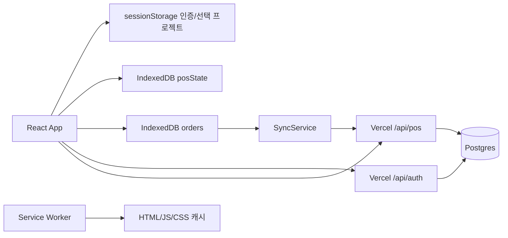

## PR #68 통합·favicon (2026-10-21)

최신 main의 결제 확인 모달과 재고 검색/상세 스타일·문서를 모두 보존하여 통합한다. PR #67의 파란 원/흰색 My SVG favicon을 public/favicon.svg에 동일하게 포함하고 Vite index.html에서 참조한다. 서비스 워커 v114의 앱 셸에 추가해 오프라인 재방문을 지원한다. 별도 pos.html/Android 런처 아이콘은 범위 밖이다.

## 재고 상세 검색 정리 (2026-10-21)

검색 초기화는 details 밖 형제 버튼으로 상세 조건 제목 오른쪽 끝에 배치하여 접기/펼치기와 독립 동작한다. 재고 상태 조건은 UI에서 제거하고 등록 날짜 date 입력을 추가한다. 한국 시간 기준 createdAt 날짜가 선택일과 일치하는 상품만 표시하며 날짜 미존재/손상은 날짜 조건 사용 시 제외한다. 조건 변경/초기화는1페이지로 복귀한다. 기존 필터 유틸의 stock 인자는 호환용으로 유지한다. 검색 글자는 목록 본문과 동일하게 데스크톱13px+1pt,모바일11px+1pt. 캐시 v112.

## 재고 상품 정보 영역·조회형 총재고 (2026-10-21)

목록은 판매 N개 / 잔여 N개로 구분한다. 상품 이름 입력은 이미지 영역으로 옮기고 form 속성으로 기존 저장 폼에 연결한다. 공통 상품 정보는 캐릭터/굿즈 종류/제작자/장르2열만 표시하며 아래에 저장된 createdAt의 상품 등록 일자를 조회 표시한다(미존재는 —). 총재고 입력을 제거하고 읽기 전용 output으로 표시하므로 이 상세 화면에서 총재고 변경은 제공하지 않는다. 배정 저장은 기존 총재고를 보존한다. 데스크톱 요약 상단 테두리/여백을 제거하고 제목/수량 요약을 좌우 배치한다. 행사 표55%/수량 각15%,배정 입력80px. 모바일은46%/18% 배분을 유지한다. 캐시 v111.

## 모바일 재고 상세 헤더·정보2열·배정 표 (2026-10-21)

모바일/터치 태블릿에서 상세 헤더를 한 행으로 고정하고 코드/수정·삭제 버튼은 축소하지 않는다. 상품명 영역만 가변 너비/최대2줄 말줄임으로 표시한다. 버튼은 padding4px 6px·최소높이30px이다. 이미지 우측 상품 이름과 세로 이미지 버튼은 유지하고 그 아래 캐릭터/굿즈 종류/제작자/장르는2열이다. 행사 배정 표는 행사46%,수량3열 각18%로 배치하고 셀·숫자 좌우 여백을 줄인다. 데스크톱/API/DB/큐 계약 유지. 캐시 v110.

## 재고 상세 여백·이미지 버튼 (2026-10-21)

재고 상세 inventory-history padding을 전체 화면에서10px로 줄인다. 모바일/터치 태블릿에서 배정 관리 헤더의 row-gap과 총재고 요약의 기존 margin-top/padding-top/border-top을 제거한다. 이미지 왼쪽·상품 이름 오른쪽의2열은 유지하고 이미지 등록/수정과 제거를 이름 아래 오른쪽 열에 한 개씩 배치한다. 이미지가 없으면 제거 버튼은 기존대로 숨긴다. 폼/파일 입력/저장/API/DB/큐 변경 없음. 캐시 v109. 아래 버튼50:50 기록은 이전 배치다.

## 결제 전 확인 모달 (2026-10-21)

SalesPage의 현금/계좌이체는 결제하시겠습니까? 확인 모달을 먼저 표시한다. Ant Design의 확인창 스타일을 자체 CSS와 native dialog로 구현하며 라이브러리는 추가하지 않는다. 취소/Escape는 변경 없이 닫고 확인만 기존 finalizeSale을 호출한다. 장바구니 참조/총액/행사/읽기 전용/저장 상태가 바뀌면 대기 확인을 무효화한다. ref 잠금으로 확인 연타를 차단한다. 기존 IndexedDB 원자 주문 저장/재전송 ID/API/Postgres 경로는 유지한다. 캐시 v113.

## 재고 판매·잔여 및 미배정 표시 (2026-10-20)

재고 목록 재고 셀은 첫 줄에 판매 N개 잔여 N개,보조줄에 총재고 N개를 표시한다. 판매는 기존 inventory.history.soldQty 합계이며 총재고와 잔여의 차이를 판매로 추정하지 않는다. 좁은 셀은 판매/잔여 문구를 생략하지 않고 줄바꿈한다. 상세의 총재고 설명 문구를 제거하고 총재고 우측에 읽기 전용 output 미배정재고(편집 중 총재고-행사 배정 합계)를 표시한다. 기존 초과 배정 오류/저장 검증은 유지한다. API/DB/큐 변경 없음. 캐시 v107.

## 모바일 재고 이미지·상품 이름 50:50 (2026-10-20)

모바일/터치 태블릿의 재고 폼은 CSS grid2개 동일 너비 열로 이미지 왼쪽/기존 상품 이름 입력 오른쪽을 배치한다. 다음 행은 이미지 등록·수정 버튼과 제거 버튼을50:50으로 배치하며 이미지가 없으면 제거 버튼은 기존처럼 숨긴다. 나머지 공통 정보는 아래 전체 너비로 유지한다. display:contents로 기존 폼/fieldset/입력 DOM을 유지하여 입력 복제 없이 재배치한다. 데스크톱과 저장/검증 계약은 유지한다. 캐시 v106. 앞선104px 이미지/버튼 우측 기록은 이전 배치다.

## 행사 배정 수량 입력 너비 (2026-10-20)

inventory-allocation-table의 수량 input은 고정110px 대신 width/max-width100%·min-width0으로 셀의 내부 너비에 맞춘다. 높이42px·우측 숫자 정렬·기존 정수/최소값/최대값 및 저장 계약은 유지한다. 캐시 v105.

## 판매 요약 제거·모바일 공통 재고 폼 (2026-10-20)

SalesPage의 단품/세트 탭 아래 행사 상태·행사명·목록 수 요약(sales-event-context)을 제거한다. 행사 선택 컨텍스트는 기존 앱 헤더에서 확인한다. 읽기 전용 판매 차단·제작자 필터·구매/주문 동작은 유지한다.

재고 폼의 모바일/터치 태블릿 미디어 분기에 한해 이미지104px와 수정/제거 버튼을 좌우로 배치하고 공통 정보 폼을 아래 전체 너비에 구분선·20px 간격으로 배치한다. 입력 필드는1열·16px 간격으로 정리하며 데스크톱152px 이미지/우측 정보2열 배치는 유지한다. 신규 등록에도 같은 모바일 이미지 편집 배치를 적용한다. 캐시 v104.

## 재고 페이지 한 줄 헤더 (2026-10-20)

InventoryPage의 목록·등록·상세는 공통 상품·재고 관리 / 재고 목록 / 현재 화면 breadcrumb(목록에서는 재고 목록까지만)를 본문 섹션 밖의 단일 헤더로 표시한다. 행사 메뉴와 같은 흰 배경과 하단 경계선, 최소56px 높이를 사용한다. 상세의 별도 PageIntro를 제거하고 목록 복귀 버튼은 유지한다. 좁은 화면에서 breadcrumb는 줄바꿈 없이 자체 가로 스크롤한다. 판매/API/DB/IndexedDB 계약 변경 없음. 캐시 v104.

## 공통 페이지 제목 상단 여백 (2026-10-20)

표시되는 page-heading은 상단 margin 데스크톱20px/모바일16px을 추가하고 기존 하단16px을 유지한다. sr-only 제목은 추가 마진에서 제외한다. 재고 목록의 별도 breadcrumb 헤더 규칙은 유지한다. 캐시 v102.

## 공통 재고 등록 헤더·이미지 편집 (2026-10-20)

/inventory/new는 목록과 같은 inventory-breadcrumb/목록 헤더 여백·글자 크기로 공통 상품·재고 관리 링크 / 상품 등록을 표시한다. 번호 미발급 배지는 표시하지 않는다. 재고 신규/상세 이미지에 기존 product-image-upload/remove 디자인과 prepareProductImage 축소,object URL 미리보기,선택 파일 제거를 적용한다. 이미지 제거는 저장 시 반영된다.

uploadInventoryImage는 inventory/{adminId}/{inventoryId}/ 경로로 기존 토큰 업로드를 재사용한다. product-images API는 로그인 소유자의 미삭제 재고 행/경로를 확인하며 기존 행사 업로드 권한과5MB/이미지 형식 제한은 유지한다. saveInventory는 optional product.imageUrl을 받으며 미전달 시 기존 값 보존,null은 제거,변경 URL은 HTTPS Vercel Blob 및 계정/재고 경로를 검증한다. 기존 계정/행사 잠금·version 검사와 공통 메타데이터 전파를 사용하고 재고/가격/판매는 유지한다.

신규 이미지는 먼저 재고 저장→Blob 업로드→반환된 재고/version으로 이미지 연결 저장한다. 실패 시 재고는 유지하고 선택 파일과 업로드 URL을 현재 화면에서 보존해 재시도한다. 새로고침/탭 종료 시 선택 파일은 다시 선택해야 하며,Blob 파일 물리 삭제는 수행하지 않는다. 캐시 v101.

## 재고 목록 헤더 마진 (2026-10-20)

inventory-list-heading은 기존 하단 여백을 상단으로 옮겨 데스크톱 margin:24px 0 0,모바일/터치 태블릿 margin:20px 0 0으로 적용한다. 하단 마진은0이다. 다른 헤더/검색/표 동작은 유지한다. 캐시 v100.

## 재고 목록 총재고 표기·글자 확대 (2026-10-20)

재고 목록의 총 N* 표기를 총재고 N개로 바꾸고 별표 각주를 제거한다. totalEstimated는 과거 누적 입고 보정 여부로 서버에 보존하며 현재 총재고 계산은 변경하지 않는다. 목록 표만 기존 본문/헤더/보조 글자 각1pt(약1.33px)를 더한다. 데스크톱13/12/11px,모바일11/10/10px에 각각1pt를 더하며 상세/다른 표는 유지한다. 캐시 v99.

## 정산 요약 접기·펼치기 (2026-10-20)

정산 전체 매출 요약은 상단 margin16px/하단0으로 변경한다. 기본 열린 native details/summary로 제목을 클릭하거나 Enter/Space로 접고 펼친다. 내부 통계는 별도4열 grid로 분리해 기존 값 크기를 유지한다. 제작자 집계 기준 및 내보내기/초기화 범위 안내 문구를 제거하고 CSV 버튼을 판매 내역 내보내기로 변경한다. 실제 내보내기·초기화 범위는 기존 전체 내역 그대로다. API/DB 변경 없음. 캐시 v98.

## 상품 이름 정렬·세트 목록 안내 정리 (2026-10-20)

세트 목록의 수량 자동 계산/재고 공유 안내 문구를 제거하고 저장 중 상태는 실제 저장 중에만 표시한다. 행사 상품 이름 링크의 최소 높이44px을 해당 표에서만 해제하고 margin/padding0으로 셀 세로 가운데 정렬을 적용한다. 모바일 제작자 보조줄은 이름 아래2px로 배치한다. 세트 표 판매가 헤더/값은 좌측 정렬이다. 재고 계산/드래그/상세 링크 동작은 유지한다. 캐시 v97.

## 주문 외부 여백·알림 정리·재고 배치 (2026-10-20)

주문 aside는 데스크톱 상단 margin20px/top20px과 max-height:calc(100% - 20px)을 사용하고 별도 상단 padding은 없앤다. 모바일은 margin/padding-top0으로 하단 sticky를 유지한다. 결제 기록 안내 문구를 제거한다. 상품 순서 훅은 드래그/취소/저장 진행·성공 멘트를 만들지 않고 실패만 반환하며, ProductsPage는 오류가 있을 때만 alert를 렌더링한다. 빈 product-reorder-status 요소는 제거한다.

재고 목록은 브레드크럼→검색→상품 추가→테이블→검색 결과→페이지 순서다. 검색 padding12px, 상세 조건 상단0/내부 padding0, 추가 버튼 padding8px 12px/주변8px로 줄인다. AGENTS.md에 사용자 요청 없는 UI 안내·사용법·완료 멘트 및 빈 상태 알림을 추가하지 않도록 명시한다. 캐시 v96. 아래 상단 padding/헤더 상품 추가/성공 알림 기록은 이전 동작이다.

## 재고 목록 타이포그래피·여백 (2026-10-20)

재고 목록에만 inventory-list-content를 적용한다. 브레드크럼 링크/현재 위치는 데스크톱20px·모바일16px이며 좁은 화면에서 줄바꿈한다. 상품 추가는44px 높이를 유지하고 헤더 아래24px/모바일20px, 검색 내부20px/16px, 검색과 결과16px, 결과와 테이블12px 간격을 둔다. 표 셀은16px/모바일12px 8px 패딩이다. 상세/신규 폼·검색 로직·페이지 나누기·데이터 계약은 유지한다. 캐시 v95.

## 판매 순서 안내 제거·정산 요약4열 (2026-10-20)

행사 판매 설정에서 그랩 핸들 조작 안내 문단을 제거하되 핸들 및 키보드 조작은 유지한다. 정산 전체 매출 요약은 모바일에서도 총 판매액/현금/계좌이체/거래 건수4열을 유지하고 값은 데스크톱18px/모바일14px로 통일한다. 좁은 열은 min-width:0과 줄바꿈으로 큰 금액의 넘침을 방지한다. 계산/API 변경 없음. 캐시 v94. 아래 모바일2열/총액30px 기록은 이전 동작이다.

## 본문 상단 여백·모바일 주문 고정 (2026-10-20)

page-content의 상단 padding은 데스크톱/모바일 모두 0이다. 판매 pos-layout과 모바일 catalog도 상단 여백을 제거하며 우측 order-panel 자체에는 데스크톱20px/모바일16px의 상단 padding을 둔다. 모바일/터치 태블릿에서 주문 패널은 판매 스크롤 영역 하단(bottom:0)에 sticky로 유지한다. 펼친 주문 목록35dvh 제한과 safe-area 하단 여백은 보존한다. API/DB/IndexedDB 변경 없음. 캐시 v93. 아래 주문 패널 일반 흐름 기록은 이전 동작이다.

## 그랩 핸들 순서 변경·모바일 상품 표 (2026-10-19)

행사 상품 목록은 페이지 나누기를 제거하고 전체 상품을 표시한다. 번호 입력/적용 폼을 제거하고 판매번호를 output으로 표시한다. useProductReorder의44px 그랩 핸들은 Pointer Events/캡처로 마우스·터치를 지원하고, 같은 표의 행에 놓을 때 기존 reorderProducts API로 대상ID/위치/드래그 시작 당시 전체 순서를1회 전달한다. 드래그 중에는 대상 위치선과 시작 행 강조만 표시하고 API 응답 후 실제 목록을 갱신한다. page-content 가장자리에서는 requestAnimationFrame으로 자동 스크롤한다. 키보드는 Enter/Space로 잡기→위/아래·Home/End로 위치 선택→Enter/Space로 저장,Escape/Tab/창 blur/포인터 취소/목록 변경/수정 잠금은 취소한다. 표 밖 놓기·동일 위치는 저장하지 않는다. 저장 중에는 새 드래그/목록 조작을 잠근다.

모바일(기존767px/터치 태블릿 분기)은 판매번호(핸들 포함),상품 이름(제작자 보조줄),판매가,판매수량,남은재고5열만 표시한다. 제작자 별도 열/초기재고/등록일은 숨기고 표 최소폭을 해제한다. 상세 헤더의 번호는 N번 상품으로 표기하며 번호·공통 코드는 동일한 중립 배지,상품명은 아래 제목으로 배치한다. 판매 카드 번호 문구도 N번 상품으로 통일한다. 서버/DB/주문 큐 계약 변경 없음. 캐시 v91. 아래 번호 입력 폼/가로 스크롤 목록 기록은 이전 UI다.

운영 등록일과 장르 보정은 사용자가 직접 SQL로 처리하기로 했다. 에이전트의 운영 보정/자격증명 다운로드는 미실행이며 이번 UI 작업에서 재시도하지 않는다.

## 재고 목록 breadcrumb·행사 판매 번호 (2026-10-19)

재고 목록의 페이지 제목/섹션 제목을 현재 위치 nav의 공통 상품·재고 관리 / 재고 목록 한 줄로 합친다. 상세/신규 등록 제목은 유지한다. 행사 상품 목록에는 판매 번호 입력/적용을 추가하고 실제 판매 카드/상세에도 번호를 표시한다. 판매 번호는 공통 상품 코드와 별개이며 행사별 활성 상품의1~N 순서다. 목록과 POS는 compareProductSaleNumber의 숫자 오름차순, 구형 미번호 자료는 코드 순서로 표시한다. 좁은 화면의 상품 표는 가로 스크롤로 입력과 상품명을 보존한다.

pos_products.sale_number INTEGER CHECK (>0)를 반복 가능한 ALTER로 추가한다. readState는 소유 행사 확인 후 행사 행 잠금 안에서 기존 번호/코드/ID 순서를1~N으로 정리하고 비활성 상품 번호는NULL로 둔다. 신규 insertProduct는 마지막 번호를 추가하며 replaceProducts는 클라이언트 saleNumber를 무시하고 DB의 기존 순서를 보존한다. 백업/복제/복원은 기존 전체 행 방식으로 번호를 보존하고 과거 미번호/중복 자료는 읽을 때 정리한다. 초기 번호 보정은 수량/가격/판매 스냅샷을 바꾸지 않는다.

reorderProducts({productId,saleNumber,expectedOrder})는 기존 행사 소유권/보관/revision/트랜잭션 잠금 경로를 사용한다. 최신 활성 상품ID 순서와 expectedOrder가 다르면409, 번호 범위/상품이 잘못되면400이다. 대상 상품을 해당 위치로 이동하고 나머지 번호를 한 트랜잭션에서 재배정한다. 다른 행사와 공통 원본/가격/재고/판매는 변경하지 않는다. App은 현재 기기의 미동기화 주문이 있으면 번호 변경도 차단하며 기존 queueVersion/scope 적용 계약을 유지한다. 주문 큐 스키마 변경 없음. 캐시 v90.

기존 행사→공통 재고 신규 채택 시 product.createdAt에 행사 created_at(없으면 현재 시각)을 저장해 새 누락을 방지한다. 이미 누락된 운영 상품은 자동으로 덮어쓰지 않는다. scripts/backfillInventoryRegistrationDates.mjs는 명시적 관리자ID의 목록 표시 상품 중 등록일 미존재/NULL/빈 문자열만 대상으로 기본 preview를 제공한다. apply는 날짜·백업 경로를 요구하며 계정/행사/재고 잠금 후 최소 이전값 백업→한국 날짜00:00 기록/version증가를 원자 실행한다. 기존 날짜/삭제 상품/타 계정/수량·가격은 보존한다. 운영 보정은 사용자가 직접 처리하기로 했으며 에이전트는 실행하지 않았다.

## 행사 상품 상세 URL·재고 표시 (2026-10-19)

상품 목록 이름은 #/products/{encoded productId}?projectId={encoded projectId} 앵커로 이동한다. usePageRoute는 상세 경로를 settings로 인식하고 productIdForHash로 안전하게 디코딩한다. App은 경로 상품ID(기존 productId 쿼리도 호환)를 ProductsPage에 전달하며 해당 행사 전환/소유권 범위를 유지한다. ProductSettingsPanel은 로컬 선택 상태 대신 URL prop을 사용하여 새로고침/뒤로·앞으로 이동에 대응한다. Ctrl/중간 클릭은 native 앵커 동작을 유지한다. 상세에서 행사 판매 설정 탭을 누르면 목록 URL로 돌아가고, 삭제 성공도 목록으로 이동한다. 없는/제거된 상품은 찾을 수 없음과 목록 링크를 표시한다. 새 상품/세트 등록 예약 경로는 유지한다.

상세의 별도 행사 상품 상세 제목·목록으로 버튼·행사 배지/장문 안내/중복 복귀 링크를 제거한다. 공통 재고 이동 링크는 코드·이름·수정·삭제가 있는 상품 헤더에 배치하며 좁은 화면에서 액션을 줄바꿈한다. EventInventoryControls 제목은 행사 배정 재고 상세, 수량4개는4열로 표시한다. 공통 재고 상세 배정/판매 이력 표의 헤더는 좌측 정렬하며 첫 열 행사명은 해당 행사 판매 설정 목록으로 이동한다. 수량 저장/API/주문 큐 계약 변경 없음. 캐시 v89. 아래 상세 안내 영역/하단 링크 기록은 이전 UI다.

## 총재고·행사별 배정 표 편집 (2026-10-19)

행사 판매 설정의 EventInventoryControls는 총재고/행사 배정 수량/판매 수량/남은 수량만 조회하고 공통 재고 상세 링크를 제공한다. 배정·회수 입력 폼은 제거한다. 공통 상세는 기존 재고 필드셋과 상시 삭제 안내/행사 선택 이동 폼을 제거하고, 행사별 재고 배정 관리 헤더의 총재고와 표의 행사 배정 수량을 외부 inventory-product-form에 연결한다. 판매/남은 수량은 output이며 수정 버튼으로 공통 정보와 배정 계획을 함께 저장한다. 미연결 소유 행사도0개 행으로 표시하여 양수 배정 시 행사 상품을 생성한다(초기 판매가는1,000원이며 행사 판매 설정에서 변경할 수 있다). 제거된 행사 상품은 수량 편집으로 자동 활성화하지 않는다.

총재고(totalStock)는 현재 창고 미배정 수량+연결 행사 initial_stock 합계이며 판매된 수량을 포함한다. 누적 입고(totalReceived)는 별도 보존한다. 과거 initial이 잔여+보존 판매량보다 작으면 잔여+판매량으로 배정 기준값을 보완하며 실제 잔여는 변경하지 않는다. 총재고 증가분은 receipt, 감소분은 correction 원장으로 기록하고 감소 시 누적 입고를 낮추지 않는다. 행사 간 배정만 바꾸면 총재고/누적 입고는 변하지 않는다. 목록의 총재고도 totalStock으로 표시한다. inventoryState는 소유 행사 목록/revision을 inventoryEvents로 반환하며 스키마 변경은 없다.

saveInventory의 optional allocationPlan={totalStock,allocations:[{projectId,productId,quantity,stock,initialStock,dataRevision}]}은 계정/소유 행사 잠금과 기존 트랜잭션 안에서 전체 연결,version,수량 스냅샷,분리 revision,정수 범위,합계<=총재고를 검사한다. 배정은 실제 판매량 및 기존 차감량(initial-stock)보다 작을 수 없다. 새 남은 수량=기존 남은 수량+배정 증감으로 계산해 과거 누락 판매/조정 차이를 보존한다. 보관 행사 증가는 거절하고 감소는 허용한다. 창고=총재고-전체 배정 합계. 행사 상품/창고/원장/공통 메타데이터를 원자 저장하며 과거 판매/취소/행사별 가격은 보존한다. 기존 saveInventory stock 계약과 transferInventory는 호환·미확인 요청 복구용으로 유지한다.

InventoryTransferRecovery는 이전 계정/원본/행사별 sessionStorage 요청을 같은 body/requestId로만 재확인한다. 네트워크/5xx는 보존,확정4xx는 해제,손상 데이터는 보존하고 수정/삭제를 차단한다. 이전 단일 키 복구도 유지한다. 새 배정 입력은 제공하지 않는다. 기존 App의 모든 소유 행사 미동기화 주문 차단,queueVersion/scope 확인,현재 행사 상태 새로 읽기를 그대로 사용한다. 캐시 v88. 아래 배정·회수 폼/기존 수량 필드셋 기록은 이전 UI다.

## 행사 판매 설정·공통 상품 관리와 배정/회수 (2026-10-19)

메뉴/페이지 제목은 행사 판매 설정과 공통 상품·재고 관리로 구분한다. 행사 기본 정보 폼은 공통 상품 정보와 이 행사 판매가를 구분한다. 사용자의 확정 지침에 따라 이름·캐릭터·굿즈 종류·제작자·장르·이미지를 어느 관리 화면에서 수정하든 공통 원본 및 연결된 모든 행사(보관/제거 상품 포함)의 마스터 정보에 반영한다. 행사별 정보 사본 편집이나 변경 사항 가져오기 UI는 제공하지 않는다. 아래 이전 행사별 장르 독립 기록은 이전 정책이다.

saveEventProduct({projectId,productId,inventoryVersion,dataRevision,product})는 계정/전체 행사 잠금·기존 요청 트랜잭션 안에서 공통 정보와 원본 version을 갱신하고 syncCommonProduct로 소유 연결 행사 마스터에 전파한다. 판매가는 대상 행사에만 저장하고 다른 행사 가격/재고/세트/과거 판매 스냅샷은 유지한다. saveInventory의 정보 변경도 같은 전파를 사용한다. 연결된 updateProductImage는 계정 우선 잠금 경로로 원본·전체 연결 이미지에 반영하며 URL 검증을 유지한다. 아직 연결이 없는 이전 상품은 첫 공통 편집/목록 조회 때 기존 채택 경로로 연결한다. replaceProducts는 연결 상품의 공통 필드를 원본 값으로 보존하여 오래된 전체 목록 요청이 정보를 되돌리지 않게 한다. readState는 공통 필드를 원본 기준으로 조회하고 행사별 가격·수량을 함께 반환한다. inventoryVersion으로 공통 수정의 오래된 초안을409로 거절한다.

양쪽 화면에 행사 판매용 재고 배정/회수 폼을 제공한다. 공통 관리에서는 행사 선택과 행사별 배정(순배정)·실제 판매·남은 수량을 비교하며, 행사 화면에서는 창고 배정 가능 수량·이 행사 판매/잔여와 이동 입력을 제공한다. 실제 판매량을 직접 수정하지 않고 기존 판매 취소/정산 링크로 정정한다. 보관 행사 추가 배정은 서버에서 막고 회수는 허용한다. 공통 관리의 미저장 기본 정보/창고 수량이 있으면 먼저 저장하도록 이동을 차단한다.

InventoryTransferForm은 양의 정수 수량과 기존 transferInventory API/이동 영수증을 사용한다. 새 이동 직전 소유 행사 상태의 dataRevision을 읽고 requestId·내용을 계정/원본/행사별 sessionStorage에 먼저 저장한다. 응답 유실·5xx·재진입 시 같은 요청으로 결과만 확인하며 확정4xx는 대기를 해제한다. 손상되거나 다른 범위의 저장 요청은 보존하고 새 이동을 차단한다. 서버도 행사 분리 revision을 검사한다. App은 대상 행사 미동기화 주문이 있으면 이동을, 현재 계정 행사 중 대기 주문이 있으면 공통 정보 수정을 차단한다. 응답은 요청 전 queueVersion과 로그인/행사 scope를 확인해 적용하고 장바구니는 현재 행사 이동 시 비운다. IndexedDB 주문 큐/DB 스키마 변경 없음. 캐시 v87.

## 이미지 버튼 테두리 스타일 (2026-10-19)

행사 상품 이미지 추가/수정·제거 버튼은 기본/hover 모두 투명 배경과 테두리로 표시한다. 등록/수정은 파란 테두리·텍스트, 제거는 붉은 테두리·텍스트이며44px 터치 크기와 키보드 초점·비활성 표시 및 파일 입력 동작은 유지한다. 캐시 v86. 아래 파란 배경 버튼 기록은 이전 스타일이다.

## 재고/행사 상품 상세 구분·장르 편집 (2026-10-19)

재고 상세 저장 성공은 alert(상품과 재고를 저장했습니다.)로 알리고 본문에 완료 메시지를 남기지 않는다. 수량 명칭은 창고 보관 수량(입력), 누적 입고 수량, 전체 남은 수량(창고+행사)으로 구분한다. 수량 변경 사유 선택 UI는 숨기며 증가분은 receipt(입고), 감소분은 correction(정정)으로 기존 원장 API에 전달한다. 누적 입고는 입고 증가분만 늘리는 기존 계약을 유지한다.

행사 상품 상세는 행사 판매 상품 배지·행사명·전용 설명과 공통 재고 복귀 링크로 현재 관리 위치를 구분한다. 헤더는 상품 코드→상품명→수정→빨간 상품 삭제 순서이며 수정은 event-product-edit-form의 기본 정보/판매가를 저장한다. 재고 배정 수량은 읽기 전용이고 중복 재고 수정 버튼은 숨긴다. 파란 이미지 등록/수정 버튼과 붉은 테두리 이미지 제거 버튼은44px 이상으로 표시하며 네이티브 파일 입력·기존 업로드 재시도 처리를 유지한다.

행사 기본 정보에 장르 입력/추천을 추가하고 ProductEditForm의 로컬 초안·정수 판매가 검증/기존 명시적 저장을 유지한다. pos_products.genre TEXT를 initDb의 반복 가능한 ALTER로 추가한다. NULL은 과거 행사 상품으로 연결된 공통 원본 장르를 조회 기본값으로 쓰며, 명시적 빈 문자열은 장르 지우기다. 행사에서 수정한 장르는 공통 원본을 바꾸지 않는다. readState는 소유 연결을 통해 productNumber와 genre를 반환하고 insertProduct/백업·복제·복원에서 장르를 보존한다. 장르는200자 이하 문자열로 검증하며 invalid 저장은 트랜잭션 rollback한다. 과거 판매 스냅샷·주문 큐는 바꾸지 않는다. 캐시 v85.

## 재고 상세 헤더와 삭제 안내 팝업 (2026-10-19)

재고 상세 헤더는 상품 코드→상품명→수정→상품 삭제 순서다. 코드는 상품명 바로 왼쪽 배지, 수정/빨간 삭제 버튼은 오른쪽 끝 액션 그룹이며 좁은 화면에서는 액션을 다음 줄 오른쪽에 배치한다. 수정은 form=inventory-product-form으로 기존 저장 폼을 제출하여 필수 입력/숫자 검증을 유지한다. 본문 하단 중복 저장 버튼과 장문의 재고/추정 설명을 제거하고 상세 헤더 아래에 행사 상품 선제 제거 안내 한 줄만 표시한다.

삭제 안내는 상시 노출하지 않는다. 상품 삭제 클릭마다 listInventory로 최신 상태/version을 확인하고, 활성 행사 상품이 있으면 native dialog 팝업에 행사명·남은 수량·해당 상품 관리 링크를 표시한다. 별도 최신 정보 불러오기 버튼은 제거했다. 닫기/×/Escape/배경 클릭으로 닫으며 브라우저 기본 모달 초점 제한과 닫기 후 초점 복귀를 사용한다. 차단 항목이 없으면 삭제 확인 후 removeInventory를 요청한다. 최신 조회 직후 등록이 바뀌어 서버409를 받으면 재조회하여 팝업을 표시한다. 이전 API의 서버 삭제 차단과 내부 이력 보존은 유지한다. 캐시 v84.

## 재고 상품 삭제 전 활성 행사 상품 제거 (2026-10-19)

재고 상세는 연결된 행사 중 archived_at이 없고 상품 is_active가 참인 항목을 삭제 차단 사유로 표시한다. 남은 수량0도 행사 등록이 유지되면 차단한다. 행사명·남은 수량과 #/products?projectId={행사ID}&productId={행사상품ID} 링크를 삭제 클릭 시 팝업으로 제공한다. 링크는 소유 행사로 명시적으로 전환하여 상품 관리 탭의 해당 상품 상세를 연다. 전환 시 장바구니를 비우고 IndexedDB 주문 큐를 보존하며 이전 행사 상태 대신 로딩을 표시한다. 행사 상품 제거는 기존 removeProduct 및 대상 행사 미동기화 주문 차단을 사용한다. 돌아와 상품 삭제를 다시 누르면 최신 상태를 자동 조회한다.

removeInventory는 기존 계정/행사 잠금·트랜잭션 안에서 같은 조건을 다시 검사하여 활성 행사 상품이 하나라도 있으면409로 거절한다. 행사 상품을 자동 제거하거나 세트를 수정하지 않는다. 서버409가 발생하면 클라이언트는 재고 목록을 재조회해 최신 차단 행사 링크를 제공한다. 보관 행사와 이미 제거된 상품, 판매 이력만 남은 경우는 삭제를 막지 않는다. inventoryState의 allocations에 archived_at/is_active를 추가한다. DB 스키마/주문 큐 변경 없음. 캐시 v83.

삭제 가능 시 removeInventory({inventoryId,version})로 원본 product.removedAt을 기록하고 version을 증가시킨다. 목록에서 제외하고 수정·신규 배정을 막되 창고/행사 수량·상품 번호·누적 입고·연결·이동 원장·과거 판매와 정산 및 취소용 정보를 내부 보존한다. 삭제는 실물 폐기가 아니며 복원 UI는 없다. 기존 수량 회수는 제거한 행사 상품을 재활성화하지 않는다. 보관 행사를 나중에 해제할 때 상품 상태를 자동 변경하지는 않는다. 같은 소유자의 삭제 재요청은 성공하고 타 계정404, 잘못된ID400, stale version409다.

## 행사 상품 제거 후 재고 상세 안내 (2026-10-19)

행사 상품 제거는 removeProduct로 is_active=false를 저장하여 행사 목록/판매에서 제외한다. 공통 원본·행사 배정 수량·연결·판매 이력은 보존하고 해당 상품과 구성 세트를 장바구니에서 제외한다. 미동기화 주문/보관 행사 차단을 유지하며, 비활성 상품은 신규 판매를 거절하고 과거 판매 취소는 허용한다. replaceProducts는 비활성 행을 보존한다.

readState는 소유 계정의 pos_inventory_links를 LEFT JOIN하여 행사 상품마다 inventoryId(연결 없으면 null)를 반환한다. 제거 성공 후 상품명을 포함한 안내에 초점을 이동하고 재고관리에서 확인하기 링크를 #/inventory/{encoded inventoryId}로 제공한다. 연결 없는 기존 상품은 이를 알리고 재고관리 목록 보기로 안내한다. 실패/취소에는 완료 안내가 생기지 않는다. 실제 재고 삭제는 이 작업에서 수행하지 않는다. 남은 행사 재고는 자동 회수하지 않는다. 재고 관리의 새 배정/회수 UI는 현재 없으므로 안내에서 회수 버튼이 있다고 약속하지 않는다. DB 스키마/IndexedDB 주문 큐 변경 없음. 캐시 v81.

## 행사 상품 신규 등록과 공통 재고 연결 (2026-10-16)

상품 관리의 재고 관리에서 상품 등록 버튼은 제거하고 새 상품 등록으로 #/products/new를 연다. InventoryProductFields를 재고 등록/행사 상품 등록에서 공유하여 상품 이름·캐릭터·굿즈 종류·제작자·장르 입력과 기본 정보 디자인을 맞춘다. 행사 등록에는 판매가(기본1000원, 무료0원 허용)와 최초 입고 수량을 추가한다. 기존 이미지 선택/저장 후 업로드/이미지 실패 재시도는 유지한다. #/inventory/new는 기존 가격 없는 창고 등록이다.

createEventProduct는 인증 계정/행사 소유권·보관 상태·분리 행사 dataRevision을 확인하고 기존 계정/행사 잠금 및 요청 트랜잭션에서 공통 원본·최초 입고 원장·행사 상품·연결·등록 영수증을 원자 저장한다. 최초 수량 전량을 행사에 배정하므로 10개 등록은 창고0/행사10/총재고10/남은재고10이다. 공통 원본 가격은0이며 입력한 판매가는 해당 행사 사본에만 저장한다. 0수량 상품도 행사 연결을 생성한다. DB 스키마 변경 없음.

등록 영수증은 pos_inventory_transfers의 create-event-product:{클라이언트 상품ID} 키로 계정별 보존한다. 정규화된 동일 내용 재요청은 현재 행사 상태를 반환하며 재고를 재설정하지 않는다. 같은 키의 다른 내용/행사는409, 상품ID 충돌도409다. 프런트는 프로젝트별 sessionStorage에 미확인 요청을 보존하고 재시도 때 같은 ID/내용을 사용한다. 확인 전 기본 정보/가격/수량을 잠그며 성공 시 영수증 대기 정보를 제거한다. 영수증의 서버 보존과 브라우저 임시 대기 저장은 서로 별개다.

App.inventoryApi는 오프라인·대상 행사 대기 주문을 차단하고 요청 전 queueVersion과 현재 로그인/행사 scope를 확인하여 응답을 IndexedDB와 브라우저 상태에 적용한다. 판매·취소·주문 큐 스키마는 변경하지 않는다. 캐시 v79.

## 재고 목록 모바일 4열·통합 검색 (2026-10-16)

재고 목록은 상품명/제작자, 캐릭터/장르, 남은재고/총재고, 등록일 4열이며 각 보조 정보는 둘째 줄에 표시한다. 목록 상품 번호는 제거하고 상세 번호는 유지한다. 표의 740px 최소 너비를 제거하고 긴 이름은 말줄임·title 및 상세 링크로 제공한다. 기존 자료 기준 총재고는 *와 표 아래 설명을 사용한다.

통합 검색은 입력 후 검색 버튼 또는 Enter로 적용한다. 상세 조건 disclosure의 재고 상태, 등록된 행사, 제작자, 굿즈 종류, 장르는 선택 즉시 AND 적용하며 페이지를 1로 돌린다. 제작자/굿즈/장르는 정확히 일치하고 행사 필터는 allocations.project_id를 기준으로 재고0 연결도 포함한다. 상세 조건을 접어도 필터는 유지하고 활성 개수를 표시한다. 초기화는 입력과 모든 필터를 해제한다. 기존 번호/코드 통합 검색 호환은 유지한다.

saveInventory는 신규 상품 JSON에 서버 createdAt을 저장하고 수정 시 기존 값을 보존한다. 날짜가 없는 기존 원본에는 null을 유지하고 목록은 —로 표시하며 과거 날짜를 추정하지 않는다. DB 스키마/판매/주문 큐 변경 없음. 캐시 v78.

## 공통 첫 줄·행사 메뉴가 있을 때만 둘째 줄 (2026-10-16)

모바일·데스크톱 모두 첫 줄은 로고→선택 행사 그룹→온라인/동기화→전역 메뉴(모바일 햄버거, 데스크톱 재고/계정) 순서다. AppHeader의 showEventNav가 참일 때만 header-secondary 전체와 두 번째 grid 행을 만든다. 따라서 재고 관리/내 계정/행사 선택/행사 추가와 미선택 상태는1줄이며 행사 판매/상품 관리/정산/행사 관리에서는2줄이다. 조건은 기존 행사 메뉴 표시 범위를 유지한다.

479px 이하는 로고64~96px/내용 너비 행사 그룹과 말줄임, 빨간 선택 해제 아이콘44px 버튼(접근성 이름 유지), 수동 동기화 버튼(장식 회전 아이콘 숨김), 햄버거44px로 한 줄에 배치한다. 480px 이상 터치는 기존 로고120px/해제 텍스트를 유지한다. 글자14px, 동기화 시각 조건/해제 가드/로그인·큐 보존은 유지한다. API/DB/IndexedDB 변경 없음. 캐시 v77. 아래 모바일 둘째 줄 동기화 배치/상시2줄 기록은 이전 동작이다.

## 로고 오른쪽 행사 그룹·시각 없는 상태 숨김 (2026-10-16)

행사명/선택 해제 그룹은 모바일·데스크톱 모두 로고 바로 오른쪽의 첫 줄에 한 번만 렌더링한다. 모바일은 둘째 줄 왼쪽 행사 메뉴/오른쪽 동기화·햄버거로 배치해2줄을 유지한다. 로고120px/기본 글자14px/내용 너비 그룹·긴 이름 생략/빨간 해제 아이콘은 유지한다. 데스크톱 동기화는 기존 재고 관리 왼쪽이다.

SyncStatus는 정상 상태에서 lastSyncedAt이 없거나 유효하지 않으면 온라인/오프라인만 표시하고 빈 하단 span을 렌더링하지 않는다. 유효한 시각이 있을 때만 하단 HH:mm:ss를 표시한다. 전송 중/오류/대기 알림과 수동 실행은 그대로다. 접근성 이름에서도 빈 구분자를 제거한다. 시각 저장/동기화 서비스 변경 없음. 캐시 v76. 아래 이전 모바일 위치/기록 없음 문구 기록은 과거 동작이다.

## 재고 원본·누적 입고·번호·행사별 판매 이력 (2026-10-16)

재고 목록/상세는 가격을 표시하거나 입력하지 않는다. 목록은 이름(상품 번호 보조표시), 제작자, 굿즈 종류, 캐릭터, 장르, 총재고/남은재고6열이다. 모바일은 표 내부만 가로 스크롤한다. 검색은 장르/상품 번호를 포함하고 재고 유무는 창고만이 아닌 전체 남은 수량 기준이다. 상세는 #/inventory/{encodeURIComponent(id)}, 등록은 #/inventory/new이며 직접 접속/새로고침/뒤로·앞으로를 지원한다. ID는 기존 내부값을 유지해 링크/주문을 보존한다.

pos_inventory에 product_number(고유), total_received(BIGINT), total_estimated를 반복 가능한 ALTER로 추가한다. pos_inventory_numbers는 계정별 임의 영문3자 접두사(계정 간 고유)와 last_number를 저장한다. 계정 행 잠금 및 DB 고유 제약 안에서 PREFIX_0001부터9999까지 발급하며 변경/재시도/이관 후에도 기존 번호를 유지한다. 한도 도달 시409로 거절하고5자리로 임의 확장하지 않는다. 장르는 product JSONB에 선택 문자열(최대200자)로 저장한다. 가격은 UI/신규 요청에서 제거하되 기존 내부 price는 호환성과 행사 사본 보존을 위해 유지한다. 신규 원본의 내부 기본가격은0이며 실제 판매가는 행사에서 관리한다.

총재고는 누적 입고 수량, 남은재고는 창고+모든 연결 행사 현재 재고다. 최초 등록은 입고로 기록하고 이후 창고 증가의 receipt만 누적 입고를 늘린다. 분실(loss)/폐기(disposal)/정정(correction)은 total_received를 변경하지 않으며 pos_inventory_adjustments에 delta/사유/시각을 남긴다. 사유/방향/정수 범위와 남은재고≤누적 입고를 검증하고 기존 version 충돌 및 요청 트랜잭션을 유지한다. UI 수량 변경 시 사유 선택을 제공한다. 판매/취소/배정/회수는 누적 입고를 변경하지 않는다.

기존 원본의 기준 총재고는 보존된 초기 수량 합계+창고와 남은재고+보존 판매량 중 큰 값으로 한 번만 정하고 total_estimated=true로 표시한다. 과거 누락된 입고 이력을 발명하지 않으며 UI에 기존 자료 기준임을 알린다. 번호/기준 수량 마이그레이션은 계정 잠금 안에서 반복 실행 가능하다.

행사별 판매 요약은 소유 계정의 판매와 원본-행사 상품 연결을 기준으로 단품+세트 구성 수량을 합산한다. 세트는 판매 시점 subItems 우선, 이전 판매만 현재 구성 fallback(추정 표시), 구성도 없으면 누락 가능 표시다. 취소로 삭제된 판매는 제외하며 삭제/초기화된 이력은 복원하지 못한다. history에 projectId/productId/eventName/soldQty/estimated를 반환한다. 링크는 #/settlement?projectId=...&productId=...&productName=...로 해당 소유 행사로 명시적으로 전환하고 판매 내역 탭을 연다. 정산 입력에는 상품 이름을 표시하되 최초 조회는 행사 상품ID로 제한해 이름 변경에도 이력을 찾는다. 사용자가 상품 검색을 바꾸거나 초기화하면 일반 검색으로 전환한다. 이동 시 기존 장바구니는 비우고 주문 큐는 보존한다. 다른 행사 전환 중에는 이전 행사 내역 대신 로딩을 표시한다.

서버 스키마/이관은 요청 전용 연결 트랜잭션과 기존 초기화 패턴을 사용한다. 운영 DB는 검증하지 않았다. 캐시 v75.

## 헤더 원래 크기·동기화 시각 배치 (2026-10-16)

2줄을 유지하면서 첫 줄 높이를 데스크톱72px/모바일64px, 모바일 로고120px, 행사명/해제/행사 메뉴14px로 복원했다. 행사 그룹은 max-content와 가용 너비 상한으로 짧은 이름에 여백을 채우지 않으며 긴 이름만 한 줄 생략한다. 선택 해제는 빨간색(#e11d48)과 기존 Icon logout을 왼쪽에 표시한다. 데스크톱은 첫 줄 로고/행사 그룹/동기화/재고·계정, 둘째 줄 행사 메뉴다. 모바일은 첫 줄 로고/동기화/햄버거, 둘째 줄 행사 그룹/가로 스크롤 행사 메뉴다. 동일 행사 그룹 JSX를 반응형 두 위치에 렌더링하되 display:none인 쪽은 접근성/탭 순서에서 제외된다.

SyncStatus의 정상 하단은 실제 마지막 주문 전송 성공 시각(lastSyncedAt, 브라우저 현지 HH:mm:ss), 기록 없거나 유효하지 않으면 동기화 기록 없음이다. 단순10초 폴링/빈 큐 확인 시각을 성공 시각으로 만들지 않는다. 전송 중/실패/대기 문구와 수동 실행/오프라인 비활성화는 보존한다. syncService는 행사 변경 때 이전 성공 시각을 지우고 이전 행사의 늦은 성공 응답으로 현재 표시를 갱신하지 않는다. 시각은 실행 중 메모리 값으로 새로고침 후 기록 없음이며 DB/IndexedDB/API 변경은 없다. 서비스 워커는 작업 트리에 준비된 공통 v74 갱신을 함께 사용한다. 이전 C안 크기/위치 기록은 아래에 보존한다.

## C안 상단 2줄 통합 (2026-10-16)

AppHeader 안으로 App의 행사 하위 메뉴를 옮겨 첫 줄은 로고/선택 행사명+선택 해제 그룹/재고·계정, 둘째 줄은 행사 하위 메뉴+동기화로 고정한다. 모바일·넓은 터치에서는 첫 줄의 재고·계정을 햄버거로 제공하고 로고64px/행사명 한 줄 말줄임/직접 선택 해제 버튼을 유지한다. 둘째 줄은 행사 메뉴만 가로 스크롤하며 동기화는 오른쪽에 남는다. 행사명 전체는 링크 접근성 이름과 title에 유지한다. 동기화의 온라인/대기/오류 문구와 수동 실행,44px 터치 높이를 유지한다.

B안 드롭다운/독립 동기화 행은 제거했다. 행사명 클릭은 다시 선택 행사 판매로 이동하며 미선택이면 행사 선택 링크다. 기존 하위 메뉴 표시 조건/현재 화면/시작 가이드 data-guide, 해제 로딩·저장 차단/로그인·IndexedDB 보존 계약은 유지한다. API/DB 변경 없음. 캐시 v73. 아래 B안 기록은 이전 동작이다.

## 행사 드롭다운 헤더 B안 (2026-10-16)

AppHeader는 로고 옆에 선택된 행사/행사명 드롭다운을 항상 표시하고 재고 관리·내 계정은 별도 상위 내비게이션으로 둔다. 행사명 클릭은 판매 이동 대신 패널 펼침이며 패널의 이 행사 판매 화면 링크가 기존 #/sales 이동을 제공한다. 행사 선택 해제는 같은 패널 안으로 이동한다. 미선택이면 행사 선택 링크를 표시한다. 모바일·넓은 터치에서도 행사명은 햄버거 밖에 표시하며 재고/계정만 햄버거에 둔다. 동기화는 독립 상태 줄로 구분하고 기존 수동 동기화/오류/대기 표시를 유지한다.

드롭다운은 일반 disclosure로 aria-expanded/aria-controls를 제공하고 Escape 닫기/행사명 포커스 복귀, 외부 pointerdown·포커스 이탈·화면/행사 변경 시 닫기를 지원한다. 햄버거와 동시에 열리지 않는다. 해제의 로딩/저장 중 차단과 기존 releaseProject의 로그인 유지/선택키·장바구니 초기화/비동기 범위 무효화/IndexedDB 보존 계약은 유지한다. API/DB 변경 없음. 캐시 v72. 아래 헤더 그룹/행사명 직접 판매 링크 기록은 이전 UI다.

## 재고 검색 공통 컴포넌트·상품 상세 폼 (2026-10-16)

SearchFilters는 정산 판매 내역의 기존 결제수단/상품/제작자 입력과 초기화를 공통 렌더러로 추출한다. 정산의 필터 의미·상태/실제 filterSales는 유지한다. 재고 목록은 같은 컴포넌트/settlement-search 스타일로 창고 재고 유무(전체/있음/없음), 상품(이름/캐릭터/굿즈 종류/코드/ID), 제작자를 AND 검색한다. 문자열은 trim/한국어 소문자 기준 부분 일치이며 제작자 없음은 제작자 미지정으로 검색한다. 검색 결과/전체 건수, 초기화, 결과 없음 문구를 제공한다. 검색 변경·초기화는1페이지로, 상세 복귀는 검색 조건을 유지하며 필터된 목록 기준10행 페이지네이션을 적용한다.

재고 상세/신규 폼은 기존 상품 상세의 management-product/management-product-body, 이미지 표시, management-details/기본 정보 fieldset/management-fields, 공통 Input/ProductValueInput과 product-stock-grid/Quantity를 사용한다. 기본 정보는 상품 이름·캐릭터·굿즈 종류·제작자·판매가, 재고는 창고 입력과 행사/전체 잔여 읽기 전용 출력이다. 기존 하나의 명시적 저장/version/실패 초안 유지 계약은 보존한다. 새 이미지 업로드·재고 배정·회수는 추가하지 않는다. API/DB 변경 없음. 캐시 v71.

## 재고 목록 테이블·상세 편집 (2026-10-16)

#/inventory는 목록→상품 재고 상세/상품 등록의 두 단계로 구성한다. 목록은 기존 상품 관리의 management-table/이름 링크/페이지네이션 스타일을 공유하며 상품 이름(제작자 보조 표기), 판매가, 창고 재고, 전체 재고 4열과 페이지당10개를 표시한다. 전체 재고는 기존과 같이 창고+행사 잔여 수량이다. 이름 클릭 시 상세에서 기존 상품 정보/창고 수량을 편집하고 수정 버튼으로 saveInventory에 저장한다. 실패 시 초안을 유지하며 성공 응답의 version으로 갱신한다. 목록 복귀 시 기존 페이지를 유지한다. 상품 추가도 별도 등록 단계에서 수행한다.

목록의 행사에 배정·창고로 회수 영역과 상시 상품·창고 재고 수정 영역을 제거한다. 새 재고 이동 입력은 제공하지 않는다. 이전 UI에서 응답을 확인하지 못한 sessionStorage 요청이 있는 경우에만 동일 requestId로 기존 이동 결과 확인을 제공하여 미확인 명령을 버리지 않는다. 공통 재고/행사 데이터와 기존 API/이동 영수증/수정 version 계약은 유지한다. 행사별 잔여 수량은 상세에서 읽기 전용 합계로 표시한다. 서버·DB·IndexedDB 변경 없음. 캐시 v70.

## 행사 헤더 그룹·중복 제목 정리 (2026-10-16)

데스크톱 상단은 [행사 + 선택 행사명 | 행사 선택 해제]를 같은 테두리/배경 그룹으로 묶고 재고 관리/내 계정과 구분한다. 로고 옆 행사명 중복 표시는 제거한다. 모바일·넓은 터치 햄버거 메뉴는 행사 링크 옆에 행사명을 표시하고 그룹 테두리는 없애며 선택 해제는 메뉴 하단에 둔다. 기존 고정/해제/판매 목적지/로그인 유지 계약은 유지한다.

PageIntro hideTitle로 상품 판매/상품 관리/정산/행사 관리 개요의 중복 제목만 시각적으로 숨긴다. 접근성 h1과 페이지 진입 포커스는 보존하고 구매/관리/정산 탭은 유지한다. 행사 관리의 이름 변경 등 상세 제목과 새 상품/세트 제목은 유지한다. 상품 관리의 내 재고에서 가져오기 패널과 props/import를 제거한다. 공통 재고 화면의 배정·회수 및 API/DB/IndexedDB 계약은 변경하지 않는다. 캐시 v69.

## 행사 선택 고정·해제와 메뉴 (2026-10-16)

행사 미선택의 행사 선택/추가 페이지에는 행사 하위 메뉴를 표시하지 않는다. 행사를 선택하면 기존 sessionStorage 선택 ID를 유지하고 상단 행사 링크의 href와 일반 클릭 모두 상품 판매(#/sales)로 연결한다. 재고 관리/내 계정에서도 헤더에 선택 행사명을 유지한다. 고정 중 #/projects 또는 #/projects/new로 이동하면 판매로 돌아오며 다른 행사 선택도 해제 전에는 허용하지 않는다.

상단 로그아웃 자리는 행사 선택 해제로 변경한다. 해제는 로그인 유지, 선택 ID/현재 화면 데이터/장바구니 초기화, 비동기 응답 범위 무효화 후 행사 선택으로 이동한다. IndexedDB 주문/판매 캐시는 삭제하지 않는다. 로딩/저장 중 해제를 차단한다. 로그아웃은 내 계정 화면에 유지한다. 행사 하위 메뉴는 선택된 행사 안에서 상품 판매/상품 관리/정산/행사 관리 네 개만 표시한다. 캐시 v68. API/DB 변경 없음.

## 계정 공통 재고와 행사 배정 (2026-10-16)

상위 메뉴는 행사 / 재고 관리 / 내 계정이다. 행사 아래 상품 판매 / 상품 관리 / 정산 / 행사 관리와 행사 선택을 제공한다. #/inventory와 #/account는 행사 미선택 상태에서도 접근한다. 공통 재고 관리는 온라인 전용이며 내 계정은 로그인 아이디를 표시한다.

pos_inventory(admin_id,id,product JSONB,stock,version)는 계정 공통 상품 원본과 미배정 창고 수량이다. pos_inventory_links(project_id,product_id,admin_id,inventory_id)는 행사 상품과 공통 상품을 연결한다. pos_inventory_transfers(admin_id,id,request)는 재고 이동 멱등성 영수증이다. 계정 삭제 시 cascade하며 행사 삭제는 공통 상품/창고/이동 영수증을 삭제하지 않는다. CREATE는 기존 초기화에서 반복 가능하게 실행한다.

POST /api/pos의 listInventory/saveInventory/transferInventory는 선택 행사와 독립적으로 인증 계정 소유권을 검사한다. 계정 행 및 계정의 행사 행을 ID 순으로 잠그고 기존 REPEATABLE READ 전용 연결 트랜잭션을 사용한다. 창고 수량·가격은 0 이상, 이동 수량은 1 이상 PostgreSQL INTEGER 범위 정수다. saveInventory는 version 충돌을 409로 거절하고 클라이언트 생성 ID/version=-1로 신규 저장 응답 유실에 의한 중복 생성을 방지한다.

재고 목록을 처음 열면 아직 연결되지 않은 기존 행사 상품을 행사 ID 길이+행사 ID+상품 ID의 별도 공통 상품으로 채택한다. 원래 상품 ID/재고/초기재고/이미지/판매/세트를 변경하지 않고 창고는 0으로 시작한다. 같은 이름/코드라도 임의 병합하지 않는다. 이후 신규/일괄/복원 행사 상품도 다음 목록 조회에서 채택된다. 따라서 과거 여러 행사에 중복 등록한 실물은 운영자가 구분·수량 확인해야 한다.

행사로 가져오기는 창고 감소+행사 현재/초기 수량 증가, 회수는 그 반대다. 최초 배정 시 행사 전용 상품 ID와 현재 원본의 상품 정보/가격/이미지 사본을 생성한다. 공통 원본 수정은 기존 행사나 과거 판매를 덮어쓰지 않는다. 행사 가격/이미지 수정과 세트는 행사별이다. 전체 남은 재고는 창고+모든 연결 행사 현재 재고이며 판매수량은 행사별 기존 집계를 유지한다. 보관 행사는 새 배정을 금지하지만 회수는 허용한다.

연결 상품을 replaceProducts로 삭제/재고 수정하거나 연결 행사를 resetDefaults로 초기화하는 요청은 409다. 행사 삭제는 연결 상품의 남은 재고를 전부 회수한 후 허용한다. upsertDefaults의 기존 행 보존은 유지한다. 행사 상품 상세 재고는 읽기 전용이고 공통 재고 배정·회수로 수량을 변경한다. 기존 행사 이미지 일괄 등록 경로와 상세 이미지 편집은 유지한다.

판매·취소는 기존 행사 상품 수량, IndexedDB 원자 주문/상태 저장, localOrderId/receipts/판매 구성 스냅샷을 그대로 사용한다. 배정량 안에서 오프라인 판매하므로 행사 간 공유 수량을 중복 예약하지 않는다. 클라이언트는 대상 행사의 PENDING/FAILED/SYNCING 주문이 있으면 이동을 차단한다. 이동 응답 유실 시 sessionStorage의 같은 requestId/payload로 확인하여 이중 반영을 방지한다. 선택 행사 이동 후 서버 상태를 queueVersion 검사를 거쳐 로컬에 반영하고 장바구니를 비운다. 다른 탭/기기는 별도 새로고침이 필요하다. 캐시 v67.

## Google Analytics 연결 (2026-10-16)

기본 Vite 진입점 index.html의 head에서 Google 태그를 async로 로드하고 측정 ID G-XH5XZSY8RJ로 초기화한다. 제공된 기본 태그만 적용하며 판매·취소 사용자 정의 이벤트나 사용자 식별 정보는 추가 전송하지 않는다. 해시 화면별 수집 설정은 GA 관리 화면의 향상된 측정 설정에 따라 별도 확인한다. 개발/Preview에서도 동일 태그가 실행된다. 외부 Google 요청은 서비스 워커의 동일 출처 캐시 대상에서 제외되며 로딩을 기다리지 않는다. 별도 pos.html 구현은 변경하지 않는다. 서비스 워커 캐시 v67.

## 모바일 인증 소개 숨김 (2026-10-16)

인증 페이지의 기존 compact 기준(767px 이하 또는 1199px 이하 넓은 터치)에서 auth-intro 전체를 display:none으로 숨긴다. 함께 만드는 부스 제목·행사별 관리 설명·장점 목록이 사라지고 로그인/가입 카드만 표시된다. 데스크톱 소개와 카드 내부 로고/짧은 설명·폼 순서는 유지한다. 캐시 v66.

## 인증 카드 순서 정리 (2026-10-16)

로그인 카드는 로고/간단한 설명→아이디/패스워드→로그인 버튼→패스워드를 잊으셨나요? 링크→회원가입 안내/회원가입 하기 버튼 순서다. 상단 전환 탭을 하단 링크 버튼으로 대체하며 가입 화면은 기존 필수 이메일/패스워드 확인과 하단 로그인 하기 버튼을 유지한다. 로그인 제목은 sr-only로 제공한다. 비밀번호 복구 API는 없으며 찾기 링크는 페이지 이동 없이 현재 재설정 미지원 안내를 펼치고 접는다. 제출 중 링크 이동·안내 전환 차단과 기존 폼 초기화 계약 유지. 캐시 v65.

## 인증 소개·카드 간격 축소 (2026-10-16)

데스크톱 auth-main의 열 간격을 72px에서 32px로, 최대 너비를 1120px에서 1000px로 줄여 소개와 인증 카드를 가깝게 배치한다. 기존 카드 높이 맞춤·내부 중앙 정렬과 모바일·넓은 터치의 최대560px/1열/28px 간격을 유지한다. 캐시 v64.

## 인증 카드 높이 맞춤 (2026-10-16)

auth-main은 데스크톱 2열에서 행을 콘텐츠 높이로 중앙 배치하고 양쪽을 stretch하여 소개와 인증 카드의 상·하단을 맞춘다. auth-card 내부는 세로 중앙 배치한다. 로그인/가입 폼이 더 길면 행이 자연스럽게 늘어나며 고정 높이나 내용 잘림은 없다. 모바일·넓은 터치 1열에서는 각 영역의 자연 높이를 유지한다. 캐시 v63.

## 행사명 강조·로그인 소개 (2026-10-16)

AppHeader는 행사명을 둥근 로고 오른쪽에 20px/굵기800(모바일·넓은 터치17px)으로 표시한다. 긴 이름은 줄바꿈하며 로고 판매 이동과 행사 미선택 대체 문구를 유지한다. 헤더 margin/padding 0 유지.

AuthPage는 합동 굿즈 부스를 위한 소개와 로그인/가입 카드를 데스크톱 2열, 모바일·넓은 터치 1열로 배치한다. 제작자별 판매금액, 이미지 상품 구분·세트 판매·재고, 행사별 기록을 소개하고 관리자별 프로젝트 안내는 제거한다. 기존 인증 필드·요청·보기 토글·오류·전환 초기화 계약을 유지한다. 서버/DB/IndexedDB 변경 없음. 서비스 워커 v62.

## PR #53 최신 main 충돌 통합 (2026-10-16)

최신 main의 신규/상세 상품 이름 입력, 초기재고 전용 수정과 포커스 추천·변경 취소 제거를 유지하면서 시작 가이드 기준점을 연결한다. 양쪽 문서 기록과 가이드/재고 CSS를 보존하고 통합 캐시는 v61로 갱신한다.

## 시작 가이드 전체 사용자 테스트 (2026-10-16)

GettingStarted는 로그인한 모든 사용자에게 행사 추가·저장, 판매 화면의 상품 관리 메뉴, 상품 추가·저장, 상품 이름 상세 진입·수정 버튼을 기준으로 안내 팝업을 표시한다. 모바일은 메뉴 열기부터 안내한다. 버튼 아래에 배치하고 하단 공간이 부족하면 위로 이동하며 스크롤·크기 변경에 위치를 갱신한다. 확인했어요 또는 대상 클릭으로 현재 안내를 접고 실제 화면 이동에 따라 다음 안내가 나타난다. API 저장 성공이나 필수 입력 검증을 대신하지 않는다.

가이드 닫기/Escape/가이드 끄기는 현재 앱 실행 동안 안내를 숨긴다. 시작 가이드로 다시 켜면 확인 기록도 초기화한다. 새로고침·재로그인 시 다시 표시하며 신규 계정 판별/DB/로컬 저장소의 완료 기록은 없다(전체 사용자 테스트 정책). 관리 탭·기존 대기 주문/읽기 전용·서버/IndexedDB 계약은 유지한다. 서비스 워커 v58.

## 신규 상품 이름 입력 (2026-10-16)

ProductCreatePage 기본 정보 첫 입력에 필수 상품 이름을 추가하고 로컬 초안 기본값을 새 굿즈로 둔다. 상품 저장 시 trim한 이름을 그대로 name에 전달하며 메타데이터에서 이름을 자동 재조합하지 않는다. 빈 이름은 저장 전에 거절한다. 신규 이미지 대체 텍스트도 입력한 이름을 사용한다. 기존 명시적 등록·실패 입력 유지·0원 가격·초기재고·이미지 등록/재시도 계약을 유지한다. API/DB/IndexedDB 변경 없음. 서비스 워커 v60. PR #55의 이미지/재고 보정은 포함하지 않은 독립 main 기반 변경이다.

## 초기재고 전용 수정·포커스 추천 (2026-10-16)

상품 상세 재고는 초기재고만 직접 편집한다. 판매수량과 남은 재고는 Quantity 출력으로 읽기 전용이다. 초기재고 변경 시 남은 재고를 초기재고−현재 판매수량으로 미리 계산하고 재고 수정 버튼에서 initialStockQty/stockQty/stock을 함께 저장한다. 초기재고가 판매수량보다 작거나 빈 값/음수/소수/안전한 정수 범위를 벗어나면 거절한다. 초기재고를 바꾸지 않은 제출은 기존 수량을 재계산하거나 API를 호출하지 않는다. 따라서 과거 조정 수량은 자동 정리하지 않으며 초기재고를 실제 변경한 시점부터 새 계산값으로 저장된다. 편집 시작 후 초기/현재 재고가 바뀌면 저장을 차단하고 새로고침을 안내한다.

기본 정보·재고 모두 변경 취소 버튼을 제거한다. 미저장 초안은 화면 이탈/새로고침으로 폐기되며 실패 시 입력 유지·수정 버튼 저장은 유지한다. 캐릭터/굿즈 종류/제작자 추천은 마우스 올림으로 열리지 않고 입력 포커스 진입 시 열린다. 포커스된 상태의 입력 검색/방향키/Enter 선택/Escape 닫기와 외부 포커스 이동 닫기를 유지한다. 서버/API/DB/판매·취소/IndexedDB 계약 변경 없음. 서비스 워커 v58. 아래 독립 재고 편집·변경 취소·호버 기록은 이전 동작이다.

## 상품 이름 직접 수정·재고 3항목 관리 (2026-10-16)

상품 상세 기본 정보에 필수 상품 이름을 추가한다. 이름/메타데이터/가격은 ProductEditForm의 수정 버튼으로 한 번에 저장한다. 이름은 trim 후 빈 값 거절이며 메타데이터 변경으로 자동 재조합하지 않는다. api/pos.js normalizeProduct는 name을 보존해 replaceProducts 이후에도 직접 입력명이 유지된다. 신규 등록의 기존 자동 이름 생성은 유지한다. productNameWithoutCreator는 실제 creatorName과 같은 접미사만 제거하여 이름 자체의 다른 괄호 문구를 보존한다. 재고 저장도 이름을 재조합하지 않는다.

상품 목록과 상세 재고 용어를 초기재고/판매수량/남은 재고로 통일한다. 상세 ProductStockForm은 초기재고(initialStockQty)와 남은 재고(stockQty/stock)의 절대 수량을 직접 편집하고 재고 수정 버튼으로 저장한다. 판매수량은 기존 managementQuantities의 현재 판매(단품+세트 구성) 집계로 읽기 전용이다. 0 이상 안전한 정수만 허용하며 변경한 재고 필드만 저장하고 편집 기준값과 현재 값이 다르면 해당 필드 덮어쓰기를 거절한다. 실패 시 초안 유지/변경 취소로 최신 값 복원. 초기재고와 남은 재고는 서로 자동 계산하지 않는다(폐기/기존 조정 등이 있을 수 있음). 판매·취소 재고 차감/복구·스냅샷/큐·프로젝트 범위·대기 주문 가드는 유지한다.

기존 추가 입고/증감 조정 선택 UI와 긴 안내 및 StockAdjustment 컴포넌트를 제거한다. 기존 initialStockQty는 추가 입고가 누적된 값일 수 있으며 이력 재분류/수량 마이그레이션은 하지 않는다. 기존 값은 운영자가 필요 시 직접 정정한다. DB 스키마 변경 없음. 서비스 워커 v57.

## 상품 명시적 수정·최근 입력값 추천 (2026-10-16)

상품 상세의 ProductEditForm은 캐릭터/굿즈 종류/제작자/판매가를 로컬 초안으로 편집한다. 입력/추천 선택은 API를 호출하지 않으며 수정 버튼(폼 제출)에서 기존 persistProducts를 한 번 호출한다. 0원 허용·안전한 정수 가격/필수 굿즈 종류를 검증하고 성공 상태를 알리며 실패 시 초안을 유지한다. 변경 취소는 현재 저장값으로 복원한다. 목록/화면을 나가면 저장 전 초안은 폐기된다. 수정 시 editable 필드만 최신 products에 합쳐 이미지·재고·코드·기타 상품과 과거 판매 스냅샷을 유지한다. 재고 반영과 이미지 등록/제거는 기존 별도 명시적 작업을 유지한다. 서버 API·IndexedDB·DB 스키마 변경 없음.

상품 신규/상세 제목 및 코드 입력, 세트 상품 선택의 코드 표시는 제거한다. 내부 ID/productCode 및 기존 코드 기반 정렬·검색은 유지한다. 신규/수정 공통 ProductValueInput은 직접 입력과 추천 선택을 지원한다. 마우스 올림/포커스/클릭 시 현재 프로젝트 상품의 createdAt 내림차순·중복 없는 값 목록을 보여주고 입력 중 부분 일치로 좁힌다. 캐릭터/제작자/굿즈 종류 모두 적용하며 별도 API 조회나 다른 행사 값 병합은 없다. 키보드 방향키·Enter 선택·Escape 닫기 및 터치 클릭을 제공한다. 상품 등록일 없는 기존 값은 뒤쪽에 표시한다. 서비스 워커 v56.

## PR #50 최신 main 충돌 통합 (2026-10-16)

상품 버튼/세트 등록 디자인과 main의 공통 uploadProductImage·인증 오류 구분·일괄 결과 강조 및 결과 영역 재시도 버튼을 함께 유지한다. 문서의 양쪽 변경 기록과 CSS를 보존한다. 서비스 워커 v55.

## 상품 추가 버튼·세트 등록 폼 (2026-10-16)

상품 목록의 상품 추가/이미지로 일괄 추가를 아이콘이 있는 인접 버튼으로 배치한다. 일괄 등록 설명과 수정 가능 안내, 상품 신규/상세의 이미지 규격 문구를 제거한다. 업로드 파일 제한과 변환 동작은 유지한다.

BundleCreatePage는 상품 등록과 같은 카드/필드 스타일을 사용한다. 상품명·캐릭터·제작자·코드 검색, 썸네일/가격/재고 체크 목록, 선택한 구성품 수량/제거, 단품 합계·세트 가격·판매 가능 수량 요약을 제공한다. 검색으로 선택을 잃지 않으며 동일 상품은 한 번만 선택한다. 900px 이하에서 요약을 하단 배치한다. 기존 App의 addBundleToSettings/persistBundles와 프로젝트·읽기 전용·대기 주문 가드, 무료 판매 및 정수 수량 계약을 유지한다. 서버/DB/IndexedDB 변경 없음. 서비스 워커 v54.
## PR #49 main 충돌 통합 (2026-10-16)

이미지 업로드/401 안내·일괄 결과 강조에 최신 main의 둥근 로고와 헤더 margin/padding 0을 함께 유지한다. 양쪽 하네스 기록을 보존하고 서비스 워커를 v54로 올리며 로고 앱 셸 캐시 경로를 유지한다.

## 이미지 인증 실패 안내 정정 (2026-10-16)

업로드 토큰 요청의 401 안내를 ‘로그인이 만료되었습니다’에서 ‘인증에 실패했습니다’로 변경한다. 현재 로그인 토큰에 만료 검사가 없고 401만으로 만료 원인을 단정할 수 없기 때문이다. 재로그인 안내와 기존 인증/업로드 흐름은 유지하며 서비스 워커는 v52다. 세션·쿠키·오프라인 권한 구조는 변경하지 않는다.

## 이미지 업로드 오류·일괄 등록 결과 (2026-10-16)

상품 일괄 추가의 상시 도움말과 상품명 클릭 안내, ‘나중에 상세에서 수정’ 버튼을 제거했다. 결과는 파란 배경·테두리·굵은 16px 텍스트로 강조하고 실패 수량 옆에 재시도 버튼을 배치한다(좁은 화면에서는 줄바꿈). 상품 유지/실패 항목만 재시도/연결 실패 URL 재사용 계약은 유지한다.

일괄·신규·상세 업로드는 uploadProductImage를 공유한다. SDK upload가 비정상 토큰 응답을 일반 영문 오류로 감추므로 기존 handleUpload 이벤트 형식으로 인증된 토큰 요청을 직접 전송하고, 성공한 제한된 client token으로 SDK client put을 호출한다. 서버는 토큰 요청 인증 후 BLOB_READ_WRITE_TOKEN 누락 시 503/BLOB_NOT_CONFIGURED를 반환한다. 클라이언트는 저장소 미설정·401·기타 HTTP/잘못된 응답을 구분하며 응답 원문/비밀값은 표시하지 않는다. 기존 소유권·보관·경로·MIME·5MiB 제한은 유지한다. 서비스 워커 v51. 운영 실패 원인은 배포 환경/실제 API 응답 확인 전에는 확정할 수 없다.

## 헤더 마진·패딩 제거 (2026-10-16)

앱 공통 헤더와 로그인·가입 헤더의 margin/padding을 모든 반응형 구간에서0으로 설정한다. 헤더 최소 높이, 내부 메뉴 간격과 버튼 터치 영역은 유지한다. 서비스 워커 v53.

## 둥근 글꼴 로고 적용 (2026-10-16)

공통 앱 및 로그인·가입 헤더에 첫 번째 둥근 글꼴 시안 /images/mybooth-rounded-logo.png를 표시한다. 파란 원·흰 My·파란 Booth, 데스크톱144px/모바일 및 넓은 터치120px, 원본1930×815 비율 유지. 기존 판매/로그인 링크와 MyBooth 대체 텍스트를 제공한다. 앱의 장식 상태 점은 로고와 중복되어 제거한다. 서비스 워커 v52 앱 셸에 선택 로고를 등록한다. 아래 텍스트 복원 기록은 이전 이력이다.

## 텍스트 로고 복원 (2026-10-15)

앱 공통 헤더와 로그인·가입 헤더의 이미지 로고를 기존 ‘마이 부스’ 텍스트로 복원한다. 앱 헤더의 기존 상태 점과 텍스트 글꼴/크기 및 판매·로그인 링크 동작을 유지한다. 이미지 전용 CSS와 앱 셸 로고 캐시 항목을 제거하며 서비스 워커 v50으로 갱신한다. 아래 이미지 로고 기록은 이전 변경 이력이다.

## 파랑·보라 그라데이션 로고 (2026-10-15)

앱 및 로그인/가입 공통 헤더는 이전 파란 MyBooth 워드마크 형태의 투명 PNG /images/mybooth-gradient-logo.png (2172×724)를 사용한다. 위·아래 파랑에서 세로 중앙 보라로 이어지며 보라 영역을 글자 본체 높이의 약60%로 넓힌 색상이며 기존 너비144px/모바일120px와 링크·alt를 유지한다. 서비스 워커 v49 앱 셸에 새 로고를 등록한다.
## 이미지로 상품 일괄 추가 (2026-10-15)

상품 목록의 ‘이미지로 일괄 추가’에서 여러 JPG/PNG/WebP를 선택하면 추가 저장 버튼 없이 등록한다. BulkProductImages는 파일별 기존 5MiB/256px 변환을 적용하고 잘못된 이미지는 제외·안내한다. 유효 이미지마다 UUID 상품 코드, 확장자를 제외한 파일명(최대100자)의 이름/굿즈 종류, 판매가·현재/초기 재고0, 빈 캐릭터/제작자, 등록일을 생성한다. 기존 상품을 포함한 replaceProducts를 한 번 실행한 뒤 기존 소유권/프로젝트 범위 이미지 API로 순차 업로드·연결한다. 대기 주문/보관/리비전 가드를 유지하며 등록 중 목록 편집을 차단한다. 상품명 클릭 후 기존 상세에서 수정한다.

상품 등록과 이미지 연결은 원자적이지 않다. 이미지 실패 시 상품은 유지하고 실패 항목만 재시도하며 연결 실패는 이미 업로드한 URL을 재사용한다. 나중에 상세에서 수정도 가능하다. 재시도 자료는 현재 화면 메모리에만 유지되므로 화면 이탈/새로고침 시 상세에서 수정한다. 상품 저장 응답 유실 시 자동 재등록하지 않고 목록 확인을 안내한다. 관리 온라인 전용/IndexedDB 판매 큐 계약은 유지하며 서버·DB 스키마 변경 없음. 서비스 워커 v47.

## 첨부 디자인 로고 교체 (2026-10-15)

공통 앱/인증 헤더는 진회색 원형과 흰색 My, 진회색 Booth를 유지한 투명 PNG /images/mybooth-charcoal-logo.png (1930×815)를 사용한다. 기존 표시 너비와 링크/대체 텍스트를 유지하며 이미지 고유 비율을 적용한다. 서비스 워커 v46 앱 셸에 새 경로를 포함한다.

## MyBooth 헤더 로고 (2026-10-15)

앱 공통 헤더와 로그인·가입 헤더에 투명 PNG 워드마크 `/images/mybooth-logo.png`를 표시한다. 접근성 대체 텍스트는 MyBooth이며 기존 판매/로그인 링크 동작을 유지한다. 데스크톱 너비144px, 모바일·넓은 터치120px 및 원본 비율을 유지한다. 서비스 워커 v45 앱 셸에 로고를 포함한다.

## 정산 상단 요약·판매 화면 버튼 (2026-10-15)

전체 매출 요약은 정산 제목 다음, 탭·제작자 필터·내역보다 먼저 표시한다. 데스크톱은 지표 4열, 모바일·넓은 터치는 2열이며 요약은 행사 전체 기준을 유지한다. 상품 판매 제목의 행사 관리 버튼을 제거하고 공통 메뉴에서 진입한다. 판매·정산 계산/API/IndexedDB 계약 변경 없음. 서비스 워커 v44.

## 오프라인 판매 저장·재전송 기반 (2026-10-15)

판매·취소는 `stateRepository.commitOrder`의 orders/posState 읽기·쓰기 트랜잭션 성공 후 UI를 갱신한다. 기존 상태 비교로 다른 탭의 오래된 화면에서 덮어쓰기를 거절한다. 취소는 원 판매 큐를 삭제하지 않고 고정 `void_${sale.id}` ID 명령을 삽입한다. 전송 순서는 생성 시각 대신 IndexedDB 자동증가 ID이며 실패 시 후속 전송을 중단한다.

동기화는 Web Locks `pos-order-upload` 배타 잠금 안에서 PENDING/FAILED/SYNCING을 회수한다. 브라우저 종료 시 잠금이 해제되므로 다음 전송자가 SYNCING을 재시도할 수 있다. HTTPS 또는 localhost의 Web Locks 지원 브라우저가 필요하며 미지원 시 큐를 보존하고 확인 필요를 표시한다. 요청은 20초 타임아웃, 시작 시 토큰/프로젝트 고정과 전송 사이 범위 검사를 유지한다. 열린 앱의 현재 행사 전송 범위는 유지한다.

`pos_sale_receipts(project_id,id,voided)`를 반복 가능한 CREATE로 추가한다. 프로젝트 FK cascade이며 판매와 같은 서버 트랜잭션/프로젝트 행 잠금에서 기록한다. 취소·판매 내역 초기화 후에도 ID를 보존해 원 판매 재전송으로 재고가 다시 차감되지 않게 한다. 기존 판매는 pos_sales 중복 검사도 유지하고 취소/초기화 시 receipt를 남긴다. 원본 서버 백업에는 receipts가 포함되지 않으며 새 프로젝트로 복원하는 기존 계약을 유지한다.

신규 판매 lines는 단품 제작자와 세트 subItems(productId/qty/name/creatorName/unitPrice)를 저장한다. 서버는 재고 차감 구성을 마스터에서 결정하고 제출된 구성과 다르면 409로 거절한다. 취소·제작자 정산은 스냅샷을 우선 사용하며 기존 판매만 최신 마스터로 fallback한다. 서버 복원 검증도 subItems 정수 수량/가격을 검사한다. 무료 판매를 유지하고 판매 수량·가격/합계·결제수단을 검증한다.

서버 상태 수신은 큐와 상태를 같은 트랜잭션에서 확인하여 대기 명령이 있거나 요청 시작 이후 큐 ID/상태가 바뀌면 로컬 스냅샷을 보존한다. 전체 병합/서버 기준 상태 분리는 후속이다. 리비전이 다른 명령도 자동 보관하지 않는다. 지속 세션·계정 스키마·전체 행사 동기화·관리 오프라인·파일 복원은 아직 미구현이다. 정적 캐시 v42.

## 페이지 설명 제거·상품 관리 버튼 통일 (2026-10-15)

공통 PageIntro의 제목 아래 설명과 전달 속성을 제거했다. 상품·세트 목록은 같은 management-add 버튼과 한 줄 management-heading을 사용하여 모바일에서도 제목 오른쪽에 추가 버튼을 유지한다. 재고 공유·삭제·백업 등의 작업 안내는 유지한다. 캐시 v41.

## 헤더·행사 추가·판매 이미지 (2026-10-15)

공통 헤더의 새로고침을 제거하고 데스크톱 동기화 버튼을 상품 판매 메뉴 왼쪽에 배치한다. 모바일은 메뉴를 닫아도 동기화 상태를 확인할 수 있도록 헤더에 유지한다. 행사 선택에서 탭을 제거하고 새 행사 추가 버튼으로 독립 주소 `#/projects/new`에 진입한다. 행사 미선택 상태에서도 인증 후 직접 진입 가능하며 생성 API와 생성 성공 후 판매 진입은 유지한다. 판매 카드 이미지는 최대 120px 정사각형으로 표시하고 신규/수정 업로드는 긴 변 최대256px로 축소한다. 기존 저장 이미지는 재업로드 전까지 원본을 유지한다. 서비스 워커 v40.

# 구조와 계약

## 판매 내역 검색 (2026-10-15)

정산 판매 내역은 결제수단 선택과 상품/제작자 부분 일치 검색을 즉시 적용한다. 조건은 AND이며 상품·제작자는 동일 판매 라인에서 일치해야 한다. 상품은 판매 라인 이름/ID와 기존 saleLineProductEntries의 세트 구성 상품명/ID를 검색한다. 앞뒤 공백·영문 대소문자를 무시하고 결과는 기존 역순 거래 전체를 표시한다. 제작자 해석은 기존 saleLineCreators를 사용하며 현재 마스터 참조의 과거 기록 한계는 유지한다. 요약 제작자 필터는 요약 탭에만 표시한다. 검색은 현재 프로젝트 메모리 조회만 수행하며 행사 전환 시 초기화한다. 표 하단의 작은 CSV/초기화 버튼은 전체 내역 대상임을 명시하고 기존 비밀번호/보관/대기 주문 가드를 유지한다. 전체 매출 요약과 CSV 범위는 검색으로 바뀌지 않는다. 서비스 워커 v39.

## 정산 화면 디자인 통일 (2026-10-15)

정산은 상품 판매와 같은 탭·제작자 필터 스타일을 사용하며 데스크톱에서 좌측 집계/내역과 우측 전체 매출 요약(350px), 모바일·넓은 터치 환경에서 세로 배치한다. 제작자별 팔레트를 제거하고 이름은 중립 텍스트로 유지한다. 요약은 항상 행사 전체 금액이며 제작자 필터는 기존처럼 제작자별 집계에만 적용한다. 판매 내역/CSV/취소/초기화 및 브라우저·IndexedDB·서버 계산 계약은 유지한다. 서비스 워커 v38.

## 상품 이미지 썸네일 업로드 (2026-10-15)

판매 카드 식별용 이미지는 신규/수정 폼 공통 prepareProductImage에서 업로드 전에 긴 변 최대256px, 비율 유지·자르기 없음·작은 원본 확대 없음으로 변환한다. 브라우저 createImageBitmap의 EXIF 방향 적용 후 canvas WebP 품질0.82로 인코딩하며 투명도를 유지한다. WebP 인코딩 미지원 시 canvas PNG 결과의 실제 MIME/확장자를 사용한다. 원본 JPG/PNG/WebP 5MiB 제한을 유지하며 변환 실패 시 원본을 업로드하지 않는다. 신규 미리보기도 변환된 파일을 표시한다. 서버 업로드 API는 기존 소유권/상품 존재/보관 상태/MIME/5MiB 검사를 유지하며 크기256 제한은 앱의 업로드 경로에서 수행한다. 기존 저장 이미지의 일괄 변환은 하지 않는다. 서비스 워커 v37.


## 신규 상품 등록 (2026-10-15)

상품 추가 버튼은 `#/products/new`로 이동하며 클릭 시 빈 상품을 서버에 저장하지 않는다. 신규 폼의 제목은 `새 굿즈 (상품 코드)`이며 코드는 진입 때 생성한 ID로 고정한다. 캐릭터(저장 필드는 호환을 위해 vtuberName), 굿즈 종류, 제작자, 판매가, 초기 재고를 입력하고 명시적 상품 저장으로 기존 replaceProducts 경로에 전달한다. 가격/재고는 0 이상의 정수이며 초기 재고를 stock/stockQty/initialStockQty에 동일하게 저장한다. 성공 시 상품 목록 복귀, 실패 시 입력 유지, 저장 전 목록 복귀 시 미등록 초안 폐기. 등록과 수정은 같은 management-product-body/management-image/management-details 레이아웃을 사용한다. 신규 이미지 선택·미리보기·제거는 로컬에서 수행하고 상품 저장 성공 후 기존 업로드 API로 이미지 저장/연결한다. 업로드는 JPG/PNG/WebP 5MiB 이하만 허용한다. 상품 저장 실패 시 이미지 업로드를 시작하지 않는다. 상품 등록 후 이미지 실패 시 등록 상태와 입력을 보존하고 이미지 단계만 재시도하며, 연결 재시도에는 이미 업로드한 URL을 재사용한다. 이미지 연결 요청은 등록 후 갱신된 dataRevision을 사용한다. 두 단계는 원자적이지 않아 이미지 실패 시 상품은 이미지 없이 등록된다. 안내 후 목록에서 수정할 수도 있다. 미리보기 object URL은 선택 변경/화면 종료 시 해제한다. 입고·재고 조정은 수정 화면에서만 제공하며 상품 수정의 세트 정보 영역은 제거했다. 기존 세트 메타데이터는 삭제하지 않고 보존한다. 수정 화면도 캐릭터 라벨을 사용하고 상품명 옆 괄호에 코드를 표시한다. 인증/프로젝트 가드와 대기 주문 차단은 기존 계약을 유지한다. 서비스 워커 v36.


## 상품 관리 등록 흐름 (2026-10-15)

상품 관리에서 기본 상품 목록 영역과 기본 상품·세트 추가/초기화 UI 및 핸들러를 제거했다. 서버의 upsertDefaults/resetDefaults API는 기존 계약을 유지한다. 세트 관리 목록에는 새 세트 등록 버튼을 표시하고, 등록 폼은 별도 해시 주소 `#/products/bundles/new`에서 제공한다. 목록 복귀와 저장 성공 시 세트 탭으로 돌아오며 저장 실패 시 입력을 유지한다. 직접 접속/새로고침/뒤로·앞으로 이동에 공통 라우팅과 인증·행사 선택 가드를 적용한다. 무료 가격·양의 정수 구성 수량 검증, 대기 주문 차단 및 프로젝트 범위 저장은 기존 처리를 사용한다. 서비스 워커 v34.


## 프로젝트 관리 (2026-10-15)

행사 목록 `#/projects`에서는 행사 선택/빈 행사 생성만 제공한다. 선택하면 `#/sales`로 진입하고, 공통 메뉴의 ‘행사 관리’에서 현재 행사의 관리 화면 `#/project`를 연다. 모든 관리 작업(이름 변경 포함)은 계정 비밀번호(payload.password)를 서버에서 확인한다. 빈 프로젝트 신규 생성은 기존처럼 비밀번호 재확인 없이 진행한다. POST renameProject는 payload.name(공백 제거 후 1~100자)을 검증하고 이름/수정일만 변경한다. POST deleteProject는 payload.confirmName을 확인하고 소유자/id/이름 조건 DELETE 한 문장의 FK cascade로 상품·세트·판매를 원자적으로 삭제한다. 관리자 소유권을 확인하고 갱신된 projects 목록을 반환한다. 프로젝트 메타데이터 작업이므로 행사 dataRevision 검사와 독립적이다.

관리 화면은 현재 행사 이름/진행·보관 상태와 상품·세트·거래·총 판매액을 표시하고, 이름 변경 `#/project/name`, 보관·해제 `/project/archive`, 복제 `/project/duplicate`, 백업·복원 `/project/backup`, 삭제 `/project/delete`를 각각 별도 해시 주소로 제공한다. 데스크톱은 좌측 메뉴/우측 작업 패널, 모바일·넓은 터치는 상단 가로 스크롤 메뉴/세로 폼이다. 주소에는 행사 ID를 넣지 않으며 sessionStorage의 선택 행사에 적용하고 진입 때 관리 대상 이름을 표시한다. 선택 행사 변경 시 입력/비밀번호/오류를 초기화한다. 주소 직접 접속·새로고침·뒤로/앞으로 이동을 지원하며 행사 미선택 시 관리 주소는 행사 선택으로 이동한다. 관리/판매 화면 이동은 장바구니를 유지한다.

복원은 독립 화면 `#/project/restore`에서 파일 선택→새 행사 정보→비밀번호 확인의 세 단계로 진행한다. 복제·복원 완료 후 새 행사를 열 수 있다. 등록된 행사가 하나도 없을 때는 행사 선택의 빈 화면에서도 복원 주소로 진입할 수 있으며, 행사 미선택 상태의 복원 직접 접속/새로고침도 허용한다. 보관 상태 배너에서 해제 화면으로 바로 이동한다. 판매/상품/세트/정산 API·서버 비밀번호 확인·IndexedDB 주문 범위는 유지한다. UI 파일은 ProjectsPage/ProjectManagementPage/ProjectRestorePage 및 공통 ProjectNavigation으로 나눈다. 서비스 워커 v33.

관리는 온라인에서만 가능하며 삭제·보관·복제·백업은 현재 기기 해당 프로젝트의 PENDING/FAILED/SYNCING 주문이 있으면 UI에서 차단한다. 삭제 성공 시 해당 상태 캐시를 제거하고 선택된 프로젝트였다면 선택/장바구니/화면 상태를 비운다. 로컬 주문 백업, 업로드 Blob 및 pos_event_archives 원본/재실행 표식은 유지하며 UI에도 명시한다. 다른 기기·탭의 새 주문과 삭제 간 경쟁은 서버가 감지하지 못하므로 모든 기기에서 판매 중단/동기화 후 삭제해야 한다. 삭제한 프로젝트에 대한 이후 주문은 소유권 검사에서 거절된다. 캐시 v33.

### 행사 보관·해제/복제/백업 계약

- `pos_projects.archived_at`(nullable TIMESTAMPTZ)을 반복 가능한 ALTER로 추가한다. 목록/상태/IndexedDB 캐시에 archivedAt을 반환·보존한다. archiveProject/unarchiveProject는 비밀번호로 이 값만 변경하고 판매/재고/정산 자료는 유지한다. 보관 중에는 서버에서 모든 판매·취소·상품·세트 변경·기본값·판매 삭제·이름 변경을 409로 거절하며 이미지 업로드 토큰도 발급하지 않는다. 조회/정산 CSV/프로젝트 백업·복제·삭제는 가능하다.
- 클라이언트는 판매·수정 컨트롤을 비활성화하고 동기화를 중지한다. 같은 브라우저의 탭에는 BroadcastChannel로 보관/해제를 전달하고 캐시 표식을 갱신한다. 이미 열린 다른 기기/연결이 끊긴 기기의 로컬 판매를 원격으로 중단할 수는 없다. 대기 큐는 삭제/자동 보관하지 않으며 서버에서 거절된 주문은 유지한다. 해제 후 다시 전송될 수 있으므로 모든 기기에서 판매 중단·동기화 후 보관하고 해제 전에 대기 내역을 확인한다.
- duplicateProject(payload.name, password)는 새로운 UUID 프로젝트에 상품(비활성 포함)·세트/구성·가격·이미지 URL을 복사하고 등록/현재 재고는 0, 판매는 빈 목록으로 시작한다. 새로운 행사에 실제 입고를 등록한다.
- backupProject(password)는 `{backup: {format:'my-booth-project', version:1, exportedAt, project, products, bundles, sales}}`를 반환한다. 원본 DB 컬럼을 보존하므로 비활성 상품·무료 가격·재고·제작자·세트·판매 lines/날짜도 포함한다. 비밀번호/인증 정보, IndexedDB 미전송 명령 및 과거 정리용 pos_event_archives는 제외한다. 이미지 바이너리 대신 공개 Blob URL만 보존한다. UTF-8 JSON 3MiB 한도이며 초과 백업은 413으로 안내한다.
- restoreProject(payload.name, password, backup)는 v1 형식/배열/중복 ID/정수 가격·재고·수량/결제수단/날짜/이미지 출처와 크기를 검증한다. 기존 프로젝트를 덮어쓰지 않고 요청 계정 소유의 새 UUID 프로젝트에 제품·세트·판매를 복원하며 보관 상태로 시작한다. 파일의 소유자/프로젝트 ID는 신뢰하지 않고 각 행의 project_id를 새 ID로 치환한다. 검토 후 비밀번호로 해제할 수 있다. 기존 주문 큐 JSON/CSV는 이 기능의 복원 형식이 아니다.
- 실제 API 진입점은 전용 pool client를 확보하고 스키마 초기화 후 REPEATABLE READ 트랜잭션에서 처리한다. 프로젝트 변경 요청은 소유자 범위의 프로젝트 행을 FOR UPDATE로 잠가 보관/해제와 판매/설정 작업을 직렬화한다. 성공 응답은 COMMIT 후 전달하고 실패 응답은 ROLLBACK한다. 복제/복원의 일부 테이블만 저장되는 것을 방지한다. 초기화 마이그레이션은 기존처럼 요청 트랜잭션 밖에서 실행한다. 직렬화 충돌은 409로 재시도를 안내한다. 실제 여러 연결의 부하/동시성 검증은 별도 PostgreSQL에서 수행해야 한다.

분석 기준: 2026-10-14 로컬 작업 트리. `api/pos.js`, `src/App.jsx`, `vite.config.js`에 기존 변경이 있는 상태를 분석했다. 운영 Vercel 계정/DB를 조회하지 않았다.

## 제품 범위

관리자가 가입/로그인하고 자신의 행사 프로젝트를 생성한다. 프로젝트별 상품·세트·판매 내역을 관리한다. 장바구니에서 현금 또는 계좌이체를 선택하면 로컬 판매를 기록한다. 실제 카드 승인, 계좌 입금 조회, 영수증 발급, 세무 처리는 구현되어 있지 않다.

현장 오프라인 판매와 인터넷 오프라인 기능을 구분해야 한다. 로그인·가입·프로젝트 목록·상품/세트 설정은 서버 통신이 필요하다. 이미 로그인하여 프로젝트를 연 탭에서는 캐시 데이터로 판매·취소를 계속할 수 있지만, 인터넷 없이 새로 앱을 시작하는 흐름은 완전하지 않다.

## 구성



| 경로 | 역할 |
| --- | --- |
| `src/App.jsx` | 인증, 프로젝트, POS, 재고·세트 설정, 집계, 백업, 로컬 판매/취소 |
| `src/database/dexie.ts` | IndexedDB 버전 1~3 및 테이블 정의 |
| `src/database/orderRepository.ts` | 프로젝트별 주문 추가/조회/상태 변경/미전송 주문 제거 |
| `src/database/stateRepository.ts` | 프로젝트별 마지막 UI 상태 저장 |
| `src/sync/syncService.ts` | 주문 순차 전송, 실패 재시도, 대기 수 집계 |
| `src/hooks/useSync.ts` | 시작 시/10초 주기/online 이벤트 동기화 |
| `src/components/SyncStatus.tsx` | 네트워크·대기 상태와 수동 동기화 버튼 |
| `src/utils/orderId.ts` | 로컬 시간 + 랜덤 6자리 hex 주문 ID |
| `api/auth.js`, `api/lib/auth.js` | 가입/로그인, scrypt 비밀번호, HMAC 토큰 |
| `api/pos.js` | 소유권 검사, 테이블 생성, 상품·세트·판매 처리 |
| `api/lib/defaultData.js` | seed version 3, 기본 상품 44개/세트 7개 |
| `public/sw.js` | 앱 셸과 정적 리소스 캐시, `/api/` 제외 |
| `vite.config.js` | React/Tailwind 빌드와 로컬 API 어댑터 |
| `pos.html` | 독립 localStorage 구현; 기본 빌드 엔트리에서 참조하지 않음 |

의존성은 React, Vite, Tailwind, Dexie, `@vercel/postgres`다. 일부 버전은 package.json에 `latest`로 선언되어 실제 재현에는 package-lock.json이 필요하다. JSX와 TS/TSX가 혼재하며 tsconfig, lint 스크립트는 없다. `npm test`는 Node 테스트 러너로 기본값 API 회귀 테스트를 실행한다.

## 저장 모델

| 저장소 | 데이터/키 | 특성 |
| --- | --- | --- |
| sessionStorage | `pos_admin_token`, `pos_admin_id`, `pos_selected_project_id` | 탭 세션 인증/선택; 새 세션 오프라인 인증 보장 없음 |
| IndexedDB `booth-pos-offline-db.orders` | 자동증가 id, projectId, localOrderId, createdAt, payload, syncStatus, retryCount, lastSyncAt | 상태: PENDING/SYNCING/SYNCED/FAILED/ARCHIVED; 주문과 취소 명령 저장 |
| IndexedDB `posState` | `project:{projectId}:latest`, state, updatedAt | products/bundles/sales 스냅샷; 주문 큐와 별도 저장 |
| Postgres `pos_admins` | id PK, email (대소문자/양끝 공백 무시 UNIQUE), password_hash, created_at | 신규 가입 이메일 필수; 기존 계정 NULL 허용 |
| `pos_projects` | id PK, admin_id FK, name, seed_version, timestamps | 관리자 소유 프로젝트; FK cascade |
| `pos_products` | (project_id,id) PK, 가격/재고/제작자/굿즈/세트 메타데이터 | stock/stock_qty 병행; 가격·재고 INTEGER |
| `pos_bundles` | (project_id,id) PK, name, price, items JSONB | items = productId/qty 목록 |
| `pos_sales` | (project_id,id) PK, time, method, total, lines JSONB | localOrderId를 서버 판매 ID로 사용 |

상품은 id/productCode, goodsType, vtuberName, creatorName, stockQty, initialStockQty, size, price, setCreatorName/setGroupName/setPrice/setDescription, isActive, timestamps를 사용한다. 표시 호환용 name/stock도 존재한다. 상품의 세트 메타데이터와 실제 판매용 bundles는 별개이며 자동 연결 로직은 없다.

상품의 선택적 `imageUrl`은 Postgres `image_url` 및 IndexedDB 상품 스냅샷에 보존한다. `/api/product-images`는 인증·프로젝트 소유권·상품 존재·경로를 확인한 후 JPG/PNG/WebP, 최대 5MiB의 Blob 직접 업로드 토큰을 발급한다. 파일은 Public Vercel Blob에 저장되고 판매 카드와 상품 관리에서 URL로 표시한다. `updateProductImage`는 해당 프로젝트/상품 이미지 URL만 변경하며 null로 제거한다. 기존 DB의 image_url은 ADD COLUMN IF NOT EXISTS로 추가한다. 이미지 교체/제거 시 이전 Blob은 삭제하지 않으므로 별도 정리 정책이 필요하다. 이미지 URL은 공개이며 민감한 이미지를 저장하지 않는다. 오프라인에서 외부 이미지 표시를 보장하지 않고 로드 실패 시 대체 문구를 표시한다.

테이블은 요청 중 `CREATE TABLE IF NOT EXISTS`로 생성한다. 이전 단일 행사 DB에는 project_id와 상품 메타데이터, 프로젝트 seed_version을 보완한다. 단일 id 기본키는 제거하고 (project_id,id) 고유 인덱스를 추가하며, 이 키 전환은 DO 블록의 한 트랜잭션에서 수행한다. 사용자가 지정한 과거 project_id=NULL 행은 admin의 7월 서코행사에 원자적으로 연결한다. admin이 없으면 NULL로 보존한다. 신규 DB는 기존처럼 복합 기본키를 사용한다. 신규 DB에서는 auth 초기화로 pos_admins가 먼저 생성되는 흐름을 전제한다.

## API

`/api/auth` 외 POS 요청은 `Authorization: Bearer <token>`을 사용한다. 토큰은 JSON payload와 HMAC-SHA256 서명으로 구성된다. iat는 있지만 만료 검사가 없다. POS는 프로젝트 관리자 소유권을 확인한다.

| 요청 | 입력 | 반환/효과 |
| --- | --- | --- |
| POST `/api/auth` | `{mode: 'signup' 또는 'login', id, password, email}` | signup만 email 필수; token/admin(id,email); mode 생략 시 login |
| GET `/api/pos` | 없음 | 로그인 관리자 projects 목록 |
| GET `/api/pos?projectId=…` | projectId | products/bundles/sales 전체 상태 |
| POST createProject | payload.name | 201 project; 빈 상품·세트·판매로 시작 |
| POST replaceProducts | payload.products | 상품 전체 삭제 후 재삽입 |
| POST replaceBundles | payload.bundles | 세트 전체 삭제 후 재삽입 |
| POST finalizeSale | localOrderId, createdAt, method, total, cart | 재고 차감, 판매 저장; 기존 판매 ID면 중복 검사 후 반환 |
| POST voidSale | payload.id | 판매 삭제 및 재고 복구; 판매 없으면 no-op |
| POST clearSales | payload.password | 비밀번호 확인 후 판매만 삭제; 재고 복구 없음 |
| POST resetDefaults | 빈 payload | 상품·세트 삭제 후 기본값 삽입, 재고 초기화; 판매 내역 유지 |
| POST upsertDefaults | 빈 payload | (project_id,id) 충돌은 DO NOTHING; 없는 기본 상품·세트만 추가, 기존 설정/현재·초기 재고/판매 유지 |

POS POST body는 `{projectId, action, payload}`다. 서버는 query/body/payload에서도 projectId를 찾는다. 판매/상품/세트 작업의 성공 응답은 전체 상태이며 프로젝트 관리 응답은 위 별도 계약을 따른다. 인증 실패 401, 관리 비밀번호 실패 403, 관리 대상 소유권/존재 실패 404, 미지원 method 405, 미지원 action/projectId 누락/잘못된 백업 400, 보관 상태/직렬화 충돌 409, 백업 크기 초과 413이며 처리 예외는 대체로 500이다. 판매 입력/재고 충돌을 세분화한 오류 계약은 아직 없다.

기본값 작업은 미동기화(PENDING/FAILED/SYNCING) 주문이 있으면 UI에서 차단한다. 비활성 기본 상품이나 수정한 세트도 업데이트 시 덮어쓰지 않는다. resetDefaults는 사용자 상품/세트를 제거하므로 유지된 과거 판매의 제작자 집계·세트 취소 결과가 달라질 수 있음을 확인 문구에 명시한다. 서버는 다른 기기의 대기 큐를 알 수 없으며 트랜잭션/동시성 문제는 P1에 남아 있다.

```json
{
  "projectId": "example-project",
  "action": "finalizeSale",
  "payload": {
    "localOrderId": "20261014-120000-ABCDEF",
    "createdAt": "2026-10-14T03:00:00.000Z",
    "method": "cash",
    "total": 1000,
    "cart": [{"type":"product","id":"P001","name":"예시","unitPrice":1000,"qty":1}]
  }
}
```

## 판매·취소·동기화 흐름

1. UI가 단품 및 세트 구성품의 장바구니 예약 수량을 계산한다. 세트 가용 수량은 구성품별 가용 재고/필요 수량의 최솟값이다.
2. 결제 시 주문 큐에 PENDING을 먼저 저장하고 로컬 재고·판매를 갱신한다. 상태 스냅샷 저장은 await하지 않는다. 결제 완료 알림은 이 시점에 표시된다.
3. SyncService가 현재 프로젝트 PENDING/FAILED를 createdAt 순으로 전송한다. 각 주문은 SYNCING → SYNCED 또는 FAILED가 되고 실패 횟수가 증가한다.
4. 서버는 단품/현재 세트 구성으로 재고를 검사하고 차감 후 판매를 삽입한다. 2026-10-15부터 실제 API 진입점은 요청 트랜잭션과 프로젝트 행 잠금으로 처리하며 보관 중 판매를 거절한다.
5. 성공 응답의 서버 상태는 SyncService에서 UI/posState에 적용하지 않는다. 자동 서버 재조회도 없다.
6. 취소는 로컬 재고·판매를 먼저 바꾼다. PENDING/FAILED 판매면 큐에서 제거하고, 제거하지 못하면 별도 voidSale 주문을 추가한다. 서버 취소는 현재 세트 구성으로 복구하고 판매를 삭제한다.

서비스 워커는 navigation에 network-first, 다른 같은 출처 GET에 stale-while-revalidate를 적용한다. 설치 시 index의 `/assets/` 링크를 캐시한다. 버전은 `booth-pos-app-v17`, 설치/활성화 시 skipWaiting/clients.claim을 사용한다. 기본 상품 이미지 `/images/default-product.svg`도 앱 셸 캐시에 포함한다. 판매 카드와 상품 관리에서 이미지가 없거나 외부 이미지 로드 실패 시 No Image SVG를 표시한다. [기본 이미지 설명](default-product-image.md).

제작자별 집계는 현재 상품·세트 정보를 참조한다. 세트 매출은 현재 구성품 단가×수량 비중으로 배분한다. 과거 구성/단가 변경 시 집계가 변할 수 있다. 판매 CSV와 IndexedDB 주문 JSON/CSV 다운로드는 제공하지만 주문 큐 복원은 없다. 서버 프로젝트의 v1 JSON 백업/복원은 위 프로젝트 관리 계약을 따른다.

## 화면 디자인 (2026-10-14)

웹 앱 표시 이름은 **마이 부스**다. 로그인 화면, 판매 화면 상단과 브라우저 탭 제목에 동일하게 표시한다. 독립 구현 `pos.html`은 별도 구현이므로 기존 이름을 유지한다.

Vite 화면은 흰색 카드/주문 패널과 파란색 주요 버튼, Pretendard 가변 폰트를 사용한다. 폰트와 OFL 라이선스는 public/fonts에 포함하며 서비스 워커 앱 셸 캐시에 폰트를 추가한다. 768px 미만에서는 판매·관리·내역 및 프로젝트/계정 메뉴를 햄버거 드롭다운으로 표시한다. 연결·대기 상태와 수동 동기화를 하나의 SyncStatus 버튼으로 묶어 햄버거 옆에 배치한다. 아이콘은 메뉴를 열면 X로 전환되고 드롭다운은 페이드/이동 애니메이션을 적용한다. 동작 줄이기 설정에서는 애니메이션을 끈다. 모바일은 64px 높이의 한 줄 앱바에서 브랜드를 왼쪽, 동기화 버튼과 햄버거를 최상단 오른쪽에 배치한다. 모바일 제목 20px, 상품명/주요 버튼 14px, 가격 16px, 보조 정보 12px, 주문 합계 28px로 구분하며 입력은 16px을 사용한다. 이전 18px 일괄 확대 규칙은 제거했다. 데스크톱은 브랜드/탐색/상태를 같은 앱바에 배치하고 768~1199px에서는 탐색만 두 번째 줄에 배치한다. 상품 목록은 독립 스크롤하고 주문금액·결제 패널은 하단 sticky 위치에 유지한다. 주문 상세는 펼쳐 수량/삭제를 조작하며, 데스크톱은 상단 메뉴와 우측 주문 패널을 유지한다. 판매 목록은 상단 단품 구매/세트 구매 탭으로 분리한다. 제작자 필터는 두 탭에 공통 적용하며 세트는 해당 제작자의 구성품을 포함하면 표시한다. 비선택 필터는 중립색이고 선택 필터만 강조색을 사용한다. 탭 전환은 장바구니를 유지하며 프로젝트 변경 시 탭/필터를 초기화한다. 판매 카드 이미지는 정사각형으로 카드 너비를 채우고 재고는 가격 옆에 표시한다. 이미지 원본은 object-contain으로 보존한다. 판매·재고·주문 큐 및 API 계약은 유지한다. 독립 구현 pos.html은 변경하지 않았다.

## 사용자·행사별 데이터 분리 (2026-10-14)

- 새 프로젝트는 빈 상품·세트·재고로 시작한다. 기본값 추가/초기화는 선택한 행사에서 사용자가 명시적으로 실행한다.
- 관리자 소유권 + project_id로 상품·가격·재고·세트·판매를 제한한다. IndexedDB 상태와 큐는 서버의 전역 고유 프로젝트 ID로 분리한다.
- project_id=NULL인 과거 상품·세트·판매만 admin 계정의 '7월 서코행사'에 연결한다. 기존 지정 프로젝트는 이동하지 않는다. admin 계정이 없으면 연결을 보류한다. 대상 행사에 동일 ID가 있으면 트랜잭션 전체가 실패하고 원본을 보존한다.
- 배포 후 인증된 POS 요청의 초기화에서 연결이 실행된다. 운영 적용 전에 백업 및 별도 DB 검증이 필요하다. 운영 DB는 이번 작업에서 조회/변경하지 않았다.
- 프로젝트 전환/로그아웃 후 늦은 상태 응답을 무시하고 동기화 배치는 시작 당시 토큰과 프로젝트로 고정한다. 다른 범위 주문은 전송하지 않는다.
- 검증: npm test 7개와 npm run build 통과. PGlite에서 빈 행사 생성, 다른 계정 접근/변경 제한, 과거 재고·무료 가격·세트·판매 보존 및 반복 연결 확인. 실제 브라우저 AUTH-01/SWITCH-01/OFF-01/02/CACHE-01 및 운영 마이그레이션은 미실행.

## 기존 12월 행사 정리 (2026-10-14)

- 사용자가 지정한 admin 소유 pxwiu2t(12 서코), s4fjgga(12월 행사)만 한 번 비운다. 행사 ID/이름을 유지하며 상품·가격·재고·세트·판매를 초기화하고 seed_version을 0으로 변경한다. 7월 서코행사 및 다른 행사/사용자는 유지한다.
- pos_event_archives에 프로젝트 및 상품·세트·판매 원본 JSON과 revision을 보관한 뒤 같은 SQL 트랜잭션에서 정리한다. 실패하면 보관/초기화를 함께 롤백한다. 보관 행이 재실행 방지 표식이므로 임의로 삭제하지 않는다. 복원 UI는 없으며 별도 DB에서 JSON 복원 절차를 검증해야 한다.
- 정리된 행사 GET 응답의 dataRevision을 POST/오프라인 주문에 포함한다. 이전 revision/누락 요청은 409로 거절한다. 새 앱은 서버 상태 확인 후 동기화를 시작하며 이전 미전송 주문을 ARCHIVED로 보존하고 재전송/대기 집계에서 제외한다. 주문 JSON/CSV 백업에는 포함한다. 대상 행사에서 revision 없는 옛 오프라인 캐시는 사용하지 않는다.
- 배포 후 인증된 POS 요청 초기화 때 적용된다. 운영 DB에는 이번 작업에서 연결하지 않았다. 운영 적용 전 백업 및 ALTER/CREATE 권한 확인, 별도 DB 검증이 필요하다. 오래 열린 탭은 배포 후 새로고침해야 한다.
- 검증: npm test, npm run build 및 git diff --check. PGlite에서 두 행사만 비움, 원본 보관, 새 상품 반복 요청 보존, 7월/다른 사용자 보존, 이전 POST 409, 소유권 제한 및 실패 시 롤백 확인. 실제 브라우저 IndexedDB ARCHIVED 전환·오프라인/온라인 전환·CACHE-01과 운영 적용은 미실행.


## 판매 카드 제작자 표시 후속 조정 (2026-10-14)

제작자 필터 영역의 세로 margin은 모바일·데스크톱 모두 위 8px/아래 12px, 라벨 위 padding은 4px로 축소했다. 판매 상품 카드의 제작자별 색상 배지를 제거하고 상품명 아래 회색 12px 보조 텍스트로 통일했다. 판매 내역의 제작자 색상 표시는 유지한다. 서비스 워커 캐시는 v15로 갱신했다.


## 상품 관리 편집 레이아웃 (2026-10-14)

상품 관리의 가로 표를 상품별 흰색 카드로 변경했다. 이미지, 기본 정보, 가격·재고, 선택 세트 정보를 분리하고 각 입력에 label을 연결한다. 데스크톱은 이미지/입력을 나란히, 모바일은 세로로 배치한다. 등록 상품 수와 저장 중 상태를 표시하고 기본값 추가·초기화 버튼은 목록 아래에 모은다. 기존 입력 자동 저장, 이미지 등록/제거, 상품 추가/삭제 및 기본값 확인·미동기화 차단 동작은 유지한다. 판매 제작자 필터의 filter-options margin-block은 0, 줄 간격은 4px, 버튼 세로 padding은 3px, 최소 높이는 데스크톱30/모바일32px다. 서비스 워커 v16.


## 상품 관리 목록·상세·탭 (2026-10-14)

상품 관리 첫 화면은 상품 이름·제작자·가격·등록일 네 열의 반응형 테이블이다. 상품명 아래 상세보기에서 해당 상품만 편집하며 목록 복귀 시 기존 페이지를 유지한다. 페이지당 10개, 이전/다음 이동과 끝 버튼 비활성화, 상품 삭제로 줄어든 페이지 수 보정을 제공한다. 등록일은 기존 createdAt을 표시하고 없거나 잘못된 날짜는 —로 표시한다. 신규 상품에는 createdAt을 넣고 즉시 상세 편집을 연다. 이미지·기본 정보·가격/재고·세트 편집과 기존 자동 저장 경로는 유지한다. 상품관리/세트관리/주문백업은 밑줄 탭과 tablist/tab/tabpanel 의미, 방향키/Home/End 이동을 사용한다. 서비스 워커 v17.

## 이메일 회원가입 (2026-10-14)

회원가입에 이메일을 필수로 입력하며 서버에서 형식/254자 제한을 검증하고 소문자/양끝 공백 제거 후 저장한다. id PK와 프로젝트 FK는 유지하며 이메일은 LOWER(BTRIM(email)) 고유 인덱스로 동시 요청에서도 중복을 차단한다. 비밀번호는 기존 scrypt 해시로 저장한다. 잘못된 가입 입력은 400, 중복 아이디/이메일은 409다. 로그인은 기존 아이디/비밀번호 방식을 유지한다.

인증 DB 초기화에서 email 컬럼/고유 인덱스를 추가하고 이메일이 NULL인 admin 계정에 사용자가 지정한 주소를 설정한다. 기존 비밀번호/프로젝트 및 이미 설정한 이메일은 보존한다. 다른 기존 계정은 NULL 이메일로 로그인할 수 있다. 운영 DB에 직접 연결하지 않았으며 배포 후 인증 요청 때 적용된다. 이메일 소유 확인/비밀번호 재설정/SNS 로그인은 구현하지 않았다. SNS 연동 시 provider+provider user ID를 별도 고유 키로 저장하고 이메일 일치만으로 기존 계정을 자동 연결하지 않는다.


## 상품·세트 수량 관리 (2026-10-14)

상품 목록은 상품명·제작자·판매가·등록 수량·판매 수량·남은 재고·등록일을 표시한다. 기존 initialStockQty는 입고 이력이 없으므로 총 입고 대신 등록 수량으로 부른다. 상세 수량은 output으로 표시하며 직접 수정하지 않는다. 추가 입고는 양의 정수를 initialStockQty와 stockQty/stock에 함께 더하고, 재고 조정은 정수 증감을 stockQty/stock에만 반영한다. 남은 재고가 음수가 되는 조정은 차단한다. 입고·조정은 확인 후 기존 replaceProducts API로 저장하며 별도 이력 테이블은 만들지 않는다.

판매 수량은 현재 sales의 단품 수량과 세트 구성품 수량×세트 판매 수량을 합산한다. 취소로 제거된 판매는 제외한다. subItems가 있으면 우선하고 없으면 현재 세트 구성을 사용하므로 과거 구성 변경·세트 삭제·판매 내역 초기화 후에는 누적 실판매 수량을 보장하지 않는다. 등록 수량−판매 수량과 남은 재고는 조정/판매 초기화로 다를 수 있다.

세트 관리는 상품 관리와 같은 제목·요약·카드/필드 스타일로 세트명, 판매가, 읽기 전용 판매 수량·판매 가능 수량, 구성품명·제작자·수량을 표시한다. 판매 가능 수량은 동일 상품 구성행을 합산한 뒤 현재 구성품 재고로 계산하며 장바구니 예약 수량은 제외한다. 세트끼리 재고를 공유하므로 가능 수량을 합산하면 안 된다. 생성 폼은 label/접근성 이름과 구성행 제거를 제공하며 무료 세트도 허용하고 가격/수량 정수 검증을 한다.

상품·세트 변경(replaceProducts/replaceBundles)은 현재 프로젝트의 미동기화 주문이 있으면 차단한다. 기존 서버 전체 상태 응답으로 대기 주문 효과가 사라지는 것을 줄이기 위한 UI 검사이며 다른 기기/요청 사이의 경쟁까지 막지는 않는다. 서버·IndexedDB 스키마/판매·취소 프로토콜은 유지한다. 서비스 워커 캐시는 v19다.

## 인증 폼 분리·패스워드 확인 (2026-10-14)

src/components/AuthPage.jsx로 인증 UI를 분리했다. 로그인/가입 전환 시 key로 폼을 재생성하여 아이디/이메일/패스워드/확인/오류/표시 상태를 초기화한다. 로그인 기본 admin 입력을 제거했다. 폼마다 고유 name/id 및 current-password/new-password 자동완성 힌트를 사용한다. 브라우저 비밀번호 관리자의 자동완성은 사용자의 브라우저 설정에 따른다.

공용 PasswordField는 패스워드와 가입 확인 각각 보기/숨기기 버튼을 제공한다. 가입은 패스워드 확인 필수 및 일치 검사 후 API 요청하고 확인값은 서버에 보내지 않는다. 제출 중 폼/전환을 비활성화하고 오류는 해당 폼에서 표시한다. App은 인증 응답의 세션/계정만 저장한다. URL/라우팅은 기존 단일 앱을 유지하며 DB/API 계약/판매/큐는 변경하지 않았다. 서비스 워커 v20.
## 페이지 분리와 공통 레이아웃 (2026-10-14)

로그인 후 화면을 src/pages/SalesPage.jsx(상품 판매), ProductsPage.jsx(상품/세트/주문 백업 관리), SettlementPage.jsx(매출 요약/판매 내역), ProjectsPage.jsx(프로젝트 목록/생성)로 분리했다. 각 주소는 #/sales, #/products, #/settlement, #/projects다. usePageRoute는 브라우저 뒤로/앞으로, 직접 주소 변경과 새로고침을 지원한다. 해시 경로이므로 서버 rewrite가 필요하지 않으며 서비스 워커 navigation/API 계약을 유지한다. 프로젝트 식별자는 기존 세션 선택을 사용하고 주소에 포함하지 않는다. 선택한 프로젝트가 없으면 프로젝트 페이지로 안내한다.

네 페이지 모두 PageLayout의 AppHeader와 PageIntro/PageTabs를 사용한다. 공통 앱바, 제목/설명/보조정보 및 밑줄 탭의 글씨/간격/키보드 이동을 통일하고 활성 페이지/탭을 표시한다. 모바일 햄버거/Escape/동기화와 헤더를 유지하며 데이터 로딩 때도 공통 헤더를 표시한다. 탭은 본문별 id/aria 연결을 사용한다. 문서 제목은 현재 페이지 이름으로 변경한다.

App은 판매/취소, 프로젝트 범위, IndexedDB/동기화 및 집계 상태를 계속 소유한다. 일반 페이지 이동과 프로젝트 목록 방문/현재 프로젝트 재선택은 장바구니를 보존한다. 다른 프로젝트 선택/생성 시 장바구니/상품/세트/판매와 필터/세트 등록 초안을 초기화하고 새 범위 데이터를 준비한 후 본문을 연다. 이전 범위의 미전송 큐는 삭제하지 않는다. 정산 제작자 필터는 요약/내역 모두에서 사용할 수 있다. PosUI와 productDisplay로 표시/입력 및 상품 이름·가격 도우미를 옮겼으며 서버 DB/주문 payload/재고 계산은 유지했다. 서비스 워커 v21. 별도 HTML 앱이나 페이지별 지연 로딩은 추가하지 않았다.

## 로그인·회원가입 주소와 로고 링크 (2026-10-14)

LoginPage/SignupPage를 별도 페이지 파일로 분리하고 #/login, #/signup 주소를 추가했다. 직접 접속/새로고침/뒤로가기를 지원하며 페이지마다 새 인증 폼으로 입력/오류/비밀번호 표시 상태를 분리한다. 회원가입은 필수 이메일과 비밀번호/비밀번호 확인 두 입력을 사용하고 일치할 때만 요청한다. 확인값은 서버에 전송하지 않는다. 로그인과 가입의 비밀번호/확인 각각 보기·숨기기 버튼과 current-password/new-password 힌트를 제공한다.

비로그인 로고는 #/login, 로그인 후 공통 헤더 로고는 #/sales로 연결한다. 선택 프로젝트가 없으면 기존처럼 프로젝트 선택을 안내한다. 비로그인 보호 페이지 접근은 로그인으로, 로그인한 사용자의 인증 페이지 접근은 판매/프로젝트로 안내한다. 로그아웃 주소도 로그인으로 변경한다. 서버 인증/판매/큐 계약은 유지하며 서비스 워커 v22. 브라우저 비밀번호 관리자 자동완성은 브라우저 설정에 따른다.

## 헤더 로고·색상 아이콘 (2026-10-14)

로그인/회원가입의 마이 부스 로고를 카드에서 상단 흰색 헤더로 옮겼다. 로그인 링크는 유지하며 인증 카드는 제목/설명부터 시작한다. PasswordField의 보기/숨기기 텍스트를 입력 오른쪽 눈/가려진 눈 SVG 아이콘으로 교체했다. aria-label/aria-pressed/aria-controls, required/자동완성/확인 일치 검사는 유지한다.

공용 Icon 컴포넌트로 판매(파란 장바구니), 관리(보라 상자), 정산(초록 명세), 프로젝트 변경(주황 폴더), 새로고침(청록 순환), 로그아웃(분홍 나가기)을 제공한다. 메뉴 글자와 링크/활성 표시를 유지하고 장식 SVG는 aria-hidden으로 처리한다. 아이콘은 앱 코드에 포함하여 추가 다운로드 없이 표시한다. 서비스 워커 v23.

## 터치 기기 반응형 보완 (2026-10-14)

기존 767px 이하 조건에 더해 뷰포트 1199px 이하이면서 hover:none + pointer:coarse인 터치 환경에도 모바일 레이아웃을 적용한다. 넓은 뷰포트를 사용하는 휴대폰과 가로 회전에서 햄버거 메뉴, 상품 2열, 하단 주문 상세/결제, 관리 편집 및 인증 헤더가 함께 전환된다. 프로젝트 목록과 정산 요약은 같은 조건에서 1열이다. 마우스 환경의 768px 이상 데스크톱 배치는 유지한다. 기종/사용자 에이전트로 판별하지 않는다.

index.html은 device-width/initial-scale을 유지하고 확대 제한을 제거하며 viewport-fit=cover를 적용한다. 앱 높이는 100vh fallback + 100dvh로 브라우저 표시 영역에 맞춘다. 서비스 워커 캐시는 v24. 브라우저가 데스크톱 모드에서 포인터 특성까지 마우스로 보고하거나 1200px 이상의 뷰포트를 사용하면 모바일 전환을 보장하지 않는다. 실기기에서 문제가 남으면 브라우저의 데스크톱 사이트 설정을 확인한다. 판매/재고/큐/API 계약 변경은 없다.

## 공통 최소 글꼴 14pt (2026-10-14)

데스크톱과 모바일 모두 CSS 14pt(약 18.67px)를 최소 크기로 사용한다. 보조 정보/표/배지/상태는 14pt, 본문·탭·주요 버튼은 15pt, 가격·강조·모바일 관리 입력은 16pt, 모바일 제목/인증 제목은 20pt, 데스크톱 제목/정산 금액은 24pt, 주문 합계는 28pt다. src/styles.css의 공통 변수와 Tailwind text 토큰으로 크기/줄 높이를 공유하며 기존 JSX의 작은 px 지정은 공통 토큰으로 교체했다. 이미지 안에 그려져 축소되던 No Image 문구도 ProductImage의 14pt HTML 텍스트로 분리한다. 이전 12~16px 화면 기록은 당시 기준이며 현재 기준은 이 절을 따른다.

큰 글씨에 맞춰 모바일 헤더는 브랜드/행사를 첫 줄, 동기화/메뉴를 둘째 줄에 표시한다. 마우스 환경의 768~1439px 헤더는 탐색을 둘째 줄로 배치한다. 389px 이하 상품은 1열, 그 외 모바일 상품은 2열이며 데스크톱 카드 최소 폭은 220px이다. 주문 요약은 필요할 때 줄바꿈하고 모바일 관리 입력은 1열이다. 높이 600px 이하/폭 1199px 이하의 터치 화면은 상품 목록 높이 60dvh로 독립 스크롤하고 주문 패널은 그 아래 일반 흐름에 배치해 앱 전체 스크롤로 결제 영역에 접근한다. 더 높은 모바일 화면은 기존 하단 주문 패널을 유지한다. 서비스 워커 v25. 판매·재고·큐·인증/API 계약 및 별도 구현 pos.html은 변경하지 않았다.

## 모바일 글꼴 복원 (2026-10-15)

데스크톱의 최소 14pt 및 15/16/20/24/28pt 계층은 유지하고, 모바일 조건(767px 이하 또는 1199px 이하 hover:none/pointer:coarse)에서만 14pt 적용 전 글꼴을 복원했다. 제목20px, 상품명/주요 버튼14px, 가격16px, 보조 정보11~12px, 주문 합계28px, 관리 입력16px를 사용한다. JSX의 개별 9~15px 글꼴과 줄 높이는 compact 변형으로 모바일에만 적용한다. 모바일 헤더 한 줄/상품2열/하단 주문 패널/관리 입력2열을 복원하고 글씨 확대 때문에 추가했던 낮은 화면의 전체 스크롤 배치를 제거했다. 데스크톱의 카드 폭과 헤더 배치는 유지한다. No Image는 데스크톱14pt/모바일12px HTML 텍스트다. 모바일 반응형 조건과 확대 허용, 판매·재고·큐·API는 유지한다. 캐시 v27(다른 작업의 v26과 구분).

## 상품·세트 관리 테이블 (2026-10-15)

세트 목록은 이름·구성품(제작자/필요 수량)·판매가·판매 수량·판매 가능 수량·삭제 열의 테이블로 표시한다. 기존 수량 계산과 등록/삭제 경로를 유지한다. 상품/세트 테이블은 컨테이너 너비에 맞춘 고정 열 배치와 줄바꿈을 사용하며 최소 850px 및 nowrap 제한을 제거했다. 1100px 미만에서는 행 내부를 항목 라벨이 있는 2열 배치로 전환하고 이름/세트 구성은 전체 너비를 사용한다. 테이블과 행/셀 역할을 유지하고 최소 14pt 글자 크기를 보존한다. 서비스 워커 캐시는 v26으로 갱신했다.

## PR #24/#25 통합 (2026-10-15)

PR #24의 상품·세트 테이블/행 라벨/컨테이너 줄바꿈/페이지 유지 구조와 PR #25의 모바일 글꼴 복원을 함께 유지한다. 1100px 미만의 관리 테이블 행 배치는 유지하며, 그 중 모바일 조건에서는 12px 표 글꼴, 마우스 데스크톱 조건에서는 최소 14pt를 사용한다. 세트 저장·주문 백업의 compact 글꼴도 유지한다. 서비스 워커는 통합 결과를 구분하는 v28이다. 앞선 v26/v27 및 공통14pt 설명은 각 시점의 기록이다.

## 관리 표·이름 클릭 상세 (2026-10-15 후속)

상품/세트 목록은 모바일에서도 헤더와 행/열을 유지한다. 모바일 및 넓은 터치 화면에서는 이름·판매가·판매 수량·남은 재고(세트는 판매 가능 수량) 4개 컬럼을 표시한다. 상품 제작자는 이름 아래, 세트 구성 종류 수는 세트명 아래에 표시한다. 모바일에서 숨기는 상품 등록 수량/등록일 및 세트 구성품/삭제는 상세 화면에서 제공한다. 데스크톱에서는 기존 전체 컬럼을 유지한다. 상품 이름 버튼으로 기존 상세 편집을 열고 별도 상세보기 버튼은 제거한다. 세트 이름 버튼으로 세트 상세를 열어 가격·판매/가용 수량·구성품별 제작자/필요 수량/남은 재고와 삭제 기능을 제공한다. 목록 복귀 버튼은 상세 진입 시 포커스를 받는다. 세트 등록은 목록 하단에 유지한다. API/DB/큐 및 수량 계산은 변경하지 않았다. 캐시 v29.

## 데스크톱 글꼴 원래 크기 복원 (2026-10-15)

데스크톱도 14pt 적용 이전의 px 글꼴로 복원했다. 제목24px, 상품명/주요 버튼14px, 가격16px, 보조 정보12px, 주문 합계30px, 기본 본문16px다. JSX의 개별9~15px 표기 및 Tailwind 기본 크기12/14/16/18/20/24/30px를 복원한다. 모바일 제목20px/합계28px 등 이미 복원된 크기는 유지한다. 사용하지 않는 compact 글꼴 변형은 제거했다. 최근 관리 테이블/상품·세트 상세/프로젝트 보관·복제·백업 기능과 레이아웃은 유지한다. No Image 텍스트는 양쪽 모두12px, 캐시는 v32다. 앞선 공통14pt 및 데스크톱14pt 유지 설명은 과거 작업 기록이다.
## 모바일 여백·세로 스크롤 (2026-10-15)

모바일·넓은 터치 환경에서 정산 catalog의 중복 padding을 제거하여 제목·탭·목록 외곽을 판매 페이지와 같은 왼쪽 16px에 맞춘다. 판매는 pos-layout, 정산은 settlement-page가 헤더 아래의 세로 스크롤을 담당하고 안쪽 catalog는 별도 세로 스크롤을 만들지 않는다. 모바일 주문 패널은 목록 뒤의 일반 흐름에 배치하여 낮은 화면에서도 본문 스크롤로 결제 버튼에 접근한다. 펼친 주문 항목만 최대35dvh 내부 스크롤을 유지한다. 공통 구매/정산 탭은 가로 스크롤을 유지하면서 세로 넘침을 숨긴다. 데스크톱 배치·판매/정산 계산·API/IndexedDB 계약은 유지한다. 서비스 워커 v43.
