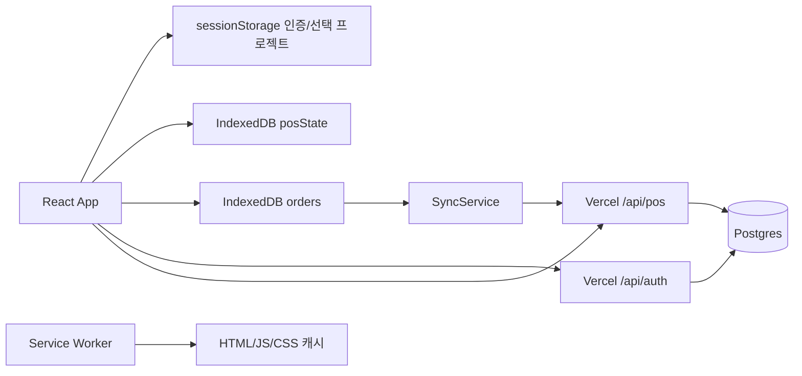

# 구조와 계약

분석 기준: 2026-10-14 로컬 작업 트리. `api/pos.js`, `src/App.jsx`, `vite.config.js`에 기존 변경이 있는 상태를 분석했다. 운영 Vercel 계정/DB를 조회하지 않았다.

## 제품 범위

관리자가 가입/로그인하고 자신의 행사 프로젝트를 생성한다. 프로젝트별 상품·세트·판매 내역을 관리한다. 장바구니에서 현금 또는 계좌이체를 선택하면 로컬 판매를 기록한다. 실제 카드 승인, 계좌 입금 조회, 영수증 발급, 세무 처리는 구현되어 있지 않다.

현장 오프라인 판매와 인터넷 오프라인 기능을 구분해야 한다. 로그인·가입·프로젝트 목록·상품/세트 설정은 서버 통신이 필요하다. 이미 로그인하여 프로젝트를 연 탭에서는 캐시 데이터로 판매·취소를 계속할 수 있지만, 인터넷 없이 새로 앱을 시작하는 흐름은 완전하지 않다.

## 구성



| 경로 | 역할 |
| --- | --- |
| `src/App.jsx` | 인증, 프로젝트, POS, 재고·세트 설정, 집계, 백업, 로컬 판매/취소 |
| `src/database/dexie.ts` | IndexedDB 버전 1~3 및 테이블 정의 |
| `src/database/orderRepository.ts` | 프로젝트별 주문 추가/조회/상태 변경/미전송 주문 제거 |
| `src/database/stateRepository.ts` | 프로젝트별 마지막 UI 상태 저장 |
| `src/sync/syncService.ts` | 주문 순차 전송, 실패 재시도, 대기 수 집계 |
| `src/hooks/useSync.ts` | 시작 시/10초 주기/online 이벤트 동기화 |
| `src/components/SyncStatus.tsx` | 네트워크·대기 상태와 수동 동기화 버튼 |
| `src/utils/orderId.ts` | 로컬 시간 + 랜덤 6자리 hex 주문 ID |
| `api/auth.js`, `api/lib/auth.js` | 가입/로그인, scrypt 비밀번호, HMAC 토큰 |
| `api/pos.js` | 소유권 검사, 테이블 생성, 상품·세트·판매 처리 |
| `api/lib/defaultData.js` | seed version 3, 기본 상품 44개/세트 7개 |
| `public/sw.js` | 앱 셸과 정적 리소스 캐시, `/api/` 제외 |
| `vite.config.js` | React/Tailwind 빌드와 로컬 API 어댑터 |
| `pos.html` | 독립 localStorage 구현; 기본 빌드 엔트리에서 참조하지 않음 |

의존성은 React, Vite, Tailwind, Dexie, `@vercel/postgres`다. 일부 버전은 package.json에 `latest`로 선언되어 실제 재현에는 package-lock.json이 필요하다. JSX와 TS/TSX가 혼재하며 tsconfig, lint 스크립트는 없다. `npm test`는 Node 테스트 러너로 기본값 API 회귀 테스트를 실행한다.

## 저장 모델

| 저장소 | 데이터/키 | 특성 |
| --- | --- | --- |
| sessionStorage | `pos_admin_token`, `pos_admin_id`, `pos_selected_project_id` | 탭 세션 인증/선택; 새 세션 오프라인 인증 보장 없음 |
| IndexedDB `booth-pos-offline-db.orders` | 자동증가 id, projectId, localOrderId, createdAt, payload, syncStatus, retryCount, lastSyncAt | 상태: PENDING/SYNCING/SYNCED/FAILED; 주문과 취소 명령 저장 |
| IndexedDB `posState` | `project:{projectId}:latest`, state, updatedAt | products/bundles/sales 스냅샷; 주문 큐와 별도 저장 |
| Postgres `pos_admins` | id PK, password_hash, created_at | 가입 또는 환경변수 기반 초기 관리자 생성 |
| `pos_projects` | id PK, admin_id FK, name, seed_version, timestamps | 관리자 소유 프로젝트; FK cascade |
| `pos_products` | (project_id,id) PK, 가격/재고/제작자/굿즈/세트 메타데이터 | stock/stock_qty 병행; 가격·재고 INTEGER |
| `pos_bundles` | (project_id,id) PK, name, price, items JSONB | items = productId/qty 목록 |
| `pos_sales` | (project_id,id) PK, time, method, total, lines JSONB | localOrderId를 서버 판매 ID로 사용 |

상품은 id/productCode, goodsType, vtuberName, creatorName, stockQty, initialStockQty, size, price, setCreatorName/setGroupName/setPrice/setDescription, isActive, timestamps를 사용한다. 표시 호환용 name/stock도 존재한다. 상품의 세트 메타데이터와 실제 판매용 bundles는 별개이며 자동 연결 로직은 없다.

상품의 선택적 `imageUrl`은 Postgres `image_url` 및 IndexedDB 상품 스냅샷에 보존한다. `/api/product-images`는 인증·프로젝트 소유권·상품 존재·경로를 확인한 후 JPG/PNG/WebP, 최대 5MiB의 Blob 직접 업로드 토큰을 발급한다. 파일은 Public Vercel Blob에 저장되고 판매 카드와 상품 관리에서 URL로 표시한다. `updateProductImage`는 해당 프로젝트/상품 이미지 URL만 변경하며 null로 제거한다. 기존 DB의 image_url은 ADD COLUMN IF NOT EXISTS로 추가한다. 이미지 교체/제거 시 이전 Blob은 삭제하지 않으므로 별도 정리 정책이 필요하다. 이미지 URL은 공개이며 민감한 이미지를 저장하지 않는다. 오프라인에서 외부 이미지 표시를 보장하지 않고 로드 실패 시 대체 문구를 표시한다.

테이블은 요청 중 `CREATE TABLE IF NOT EXISTS`로 생성한다. 기존 테이블에 빠진 컬럼을 보완하는 ALTER/migration은 없다. 신규 DB에서는 auth 초기화로 pos_admins가 먼저 생성되는 흐름을 전제한다.

## API

`/api/auth` 외 POS 요청은 `Authorization: Bearer <token>`을 사용한다. 토큰은 JSON payload와 HMAC-SHA256 서명으로 구성된다. iat는 있지만 만료 검사가 없다. POS는 프로젝트 관리자 소유권을 확인한다.

| 요청 | 입력 | 반환/효과 |
| --- | --- | --- |
| POST `/api/auth` | `{mode: 'signup' 또는 'login', id, password}` | token/admin; mode 생략 시 login |
| GET `/api/pos` | 없음 | 로그인 관리자 projects 목록 |
| GET `/api/pos?projectId=…` | projectId | products/bundles/sales 전체 상태 |
| POST createProject | payload.name | 201 project; 기본 데이터로 초기화 |
| POST replaceProducts | payload.products | 상품 전체 삭제 후 재삽입 |
| POST replaceBundles | payload.bundles | 세트 전체 삭제 후 재삽입 |
| POST finalizeSale | localOrderId, createdAt, method, total, cart | 재고 차감, 판매 저장; 기존 판매 ID면 중복 검사 후 반환 |
| POST voidSale | payload.id | 판매 삭제 및 재고 복구; 판매 없으면 no-op |
| POST clearSales | payload.password | 비밀번호 확인 후 판매만 삭제; 재고 복구 없음 |
| POST resetDefaults | 빈 payload | 상품·세트 삭제 후 기본값 삽입, 재고 초기화; 판매 내역 유지 |
| POST upsertDefaults | 빈 payload | (project_id,id) 충돌은 DO NOTHING; 없는 기본 상품·세트만 추가, 기존 설정/현재·초기 재고/판매 유지 |

POS POST body는 `{projectId, action, payload}`다. 서버는 query/body/payload에서도 projectId를 찾는다. createProject 외 성공 응답은 전체 상태다. 인증 실패 401, 미지원 method 405, 미지원 action/projectId 누락 400, 처리 예외는 대체로 500이다. 입력/재고 충돌을 구분한 오류 계약은 아직 없다.

기본값 작업은 미동기화(PENDING/FAILED/SYNCING) 주문이 있으면 UI에서 차단한다. 비활성 기본 상품이나 수정한 세트도 업데이트 시 덮어쓰지 않는다. resetDefaults는 사용자 상품/세트를 제거하므로 유지된 과거 판매의 제작자 집계·세트 취소 결과가 달라질 수 있음을 확인 문구에 명시한다. 서버는 다른 기기의 대기 큐를 알 수 없으며 트랜잭션/동시성 문제는 P1에 남아 있다.

```json
{
  "projectId": "example-project",
  "action": "finalizeSale",
  "payload": {
    "localOrderId": "20261014-120000-ABCDEF",
    "createdAt": "2026-10-14T03:00:00.000Z",
    "method": "cash",
    "total": 1000,
    "cart": [{"type":"product","id":"P001","name":"예시","unitPrice":1000,"qty":1}]
  }
}
```

## 판매·취소·동기화 흐름

1. UI가 단품 및 세트 구성품의 장바구니 예약 수량을 계산한다. 세트 가용 수량은 구성품별 가용 재고/필요 수량의 최솟값이다.
2. 결제 시 주문 큐에 PENDING을 먼저 저장하고 로컬 재고·판매를 갱신한다. 상태 스냅샷 저장은 await하지 않는다. 결제 완료 알림은 이 시점에 표시된다.
3. SyncService가 현재 프로젝트 PENDING/FAILED를 createdAt 순으로 전송한다. 각 주문은 SYNCING → SYNCED 또는 FAILED가 되고 실패 횟수가 증가한다.
4. 서버는 단품/현재 세트 구성으로 재고를 검사하고 차감 후 판매를 삽입한다. 이 일련의 SQL은 트랜잭션으로 묶이지 않는다.
5. 성공 응답의 서버 상태는 SyncService에서 UI/posState에 적용하지 않는다. 자동 서버 재조회도 없다.
6. 취소는 로컬 재고·판매를 먼저 바꾼다. PENDING/FAILED 판매면 큐에서 제거하고, 제거하지 못하면 별도 voidSale 주문을 추가한다. 서버 취소는 현재 세트 구성으로 복구하고 판매를 삭제한다.

서비스 워커는 navigation에 network-first, 다른 같은 출처 GET에 stale-while-revalidate를 적용한다. 설치 시 index의 `/assets/` 링크를 캐시한다. 버전은 `booth-pos-app-v5`, 설치/활성화 시 skipWaiting/clients.claim을 사용한다. 기본 상품 이미지 `/images/default-product.png`도 앱 셸 캐시에 포함한다. 판매 카드와 상품 관리에서 이미지가 없거나 외부 이미지 로드 실패 시 기본 SD 캐릭터를 표시한다. [이미지 생성 기록](default-product-image.md).

제작자별 집계는 현재 상품·세트 정보를 참조한다. 세트 매출은 현재 구성품 단가×수량 비중으로 배분한다. 과거 구성/단가 변경 시 집계가 변할 수 있다. 판매 CSV와 IndexedDB 주문 JSON/CSV 다운로드가 있지만 복원 UI는 없다.

## 화면 디자인 (2026-10-14)

Vite 화면은 흰색 카드/주문 패널과 파란색 주요 버튼, Pretendard 가변 폰트를 사용한다. 폰트와 OFL 라이선스는 public/fonts에 포함하며 서비스 워커 앱 셸 캐시에 폰트를 추가한다. 768px 미만에서는 상품과 주문 패널을 세로로 배치하고 페이지 스크롤을 사용한다. 판매·재고·주문 큐 및 API 계약은 유지한다. 독립 구현 pos.html은 변경하지 않았다.
